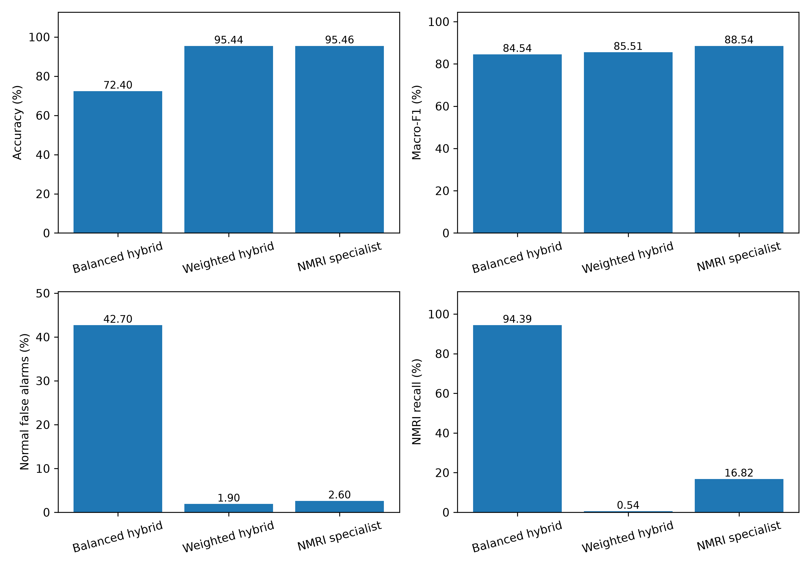

# CE-BPSO-AHDL-IDS: Compute-Efficient Binary Particle Swarm Optimization-Based Architecture Search for Hybrid Deep Learning Intrusion Detection in the Internet of Things

**Authors:** Abdur Rahim, Arpit Kumar Singh, Gosala Buela

**Institution:** Indian Institute of Information Technology, Design and Manufacturing, Kancheepuram

This course project implements binary particle swarm optimization (BPSO) for hybrid neural architecture search and evaluates training-budget allocation for IoT intrusion detection. It includes CNN/GRU models, Successive Halving (SH), Hyperband, DEHB, predictive allocation variants, execution optimizations and an archive-free policy with SH fallback. Research experiments use the official Gas Pipeline dataset. ToN-IoT, Bot-IoT and SWaT adapters are included; their generated fixtures verify software only.

## Results

### Detector performance

Mean test results across three hybrid-model seeds on the frozen Gas Pipeline split:

| Model | Accuracy | Macro-F1 | Normal false alarms | NMRI recall |
|---|---:|---:|---:|---:|
| Balanced hybrid reference | 72.40% | 0.8454 | 42.70% | 94.39% |
| Square-root-weighted hybrid | 95.44% | 0.8551 | 1.90% | 0.54% |
| Hybrid with NMRI specialist | 95.46% | 0.8854 | 2.60% | 16.82% |

The final specialist pipeline detects 92.23% of attacks overall, but most NMRI attacks remain undetected. One training-fitted specialist is shared across three hybrid seeds. These are fixed-reference and specialist results, not a demonstrated BPSO-selected winning detector. The historical test split was examined during development, so independent confirmation is still required.

Evidence: [reference summary](docs/latex/evidence/final_summary.json), [weighted-hybrid summary](docs/latex/evidence/false_alarm_summary.json), [specialist summary](docs/latex/evidence/nmri_summary.json), [false-alarm study](docs/false_alarm_optimization.md), and [NMRI study](docs/nmri_balance.md).

### Final archive-free search comparison

The matched experiment uses seeds 601–603, 8,192 training and 4,096 validation records, eight classes, 3/10/30-epoch fidelities, a target validation macro-F1 of 0.6, and a 20-GPU-second cap. Target-or-cap consumption and fixed-compute quality are separate experiments. Failed targets remain in the averages; ± denotes sample standard deviation across search seeds.

| Method | Target-or-cap GPU seconds | Target reached | 20-second validation macro-F1 |
|---|---|---|---|
| BPSO | 16.824 | 1/3 | 0.2696 ± 0.3715 |
| BPSO + SH | 12.004 | 2/3 | 0.5030 ± 0.3231 |
| DEHB | 6.778 | 3/3 | 0.7356 ± 0.0402 |
| Offline UA | 12.631 | 2/3 | 0.5391 ± 0.2719 |
| Archive-free full | 11.947 | 2/3 | 0.5030 ± 0.3231 |
| Online prediction | 11.919 | 2/3 | 0.5030 ± 0.3231 |
| Online + uncertainty | 11.950 | 2/3 | 0.5030 ± 0.3231 |

Archive-free full consumed **28.99% less online GPU time than BPSO**, but made **zero predictive promotion decisions** in the primary trials and used SH fallback. Its 0.47% timing difference from SH is execution variation, not evidence of a learning advantage. DEHB was the strongest measured control. Offline UA also requires a historical predictor archive costing **403.819 GPU seconds**, which is excluded from the online-time column above; its standalone target-or-cap total is 416.450 GPU seconds. The archive-free modes require zero separately trained GPU archive jobs.

The final study contains 42 matched runs and one separate 120-second cold-start diagnostic. The diagnostic matured 16 terminal architectures, fitted one CPU predictor and applied no predictive promotions. It is not a matched superiority comparison. Timing is synchronized training/validation elapsed, including host stalls; it is not pure kernel time or energy. Final epochs may overrun the cap, while strict-budget score checks exclude observations beyond the horizon.

Evidence: [complete final report](results/ua_amf_online_20261108/REPORT.md), [comparison CSV](results/ua_amf_online_20261108/comparison.csv), [per-seed measurements](results/ua_amf_online_20261108/seed_results.csv), [anytime measurements](results/ua_amf_online_20261108/anytime.csv), [campaign costs](results/ua_amf_online_20261108/campaign_costs.csv), and [method description](docs/archive_free_ua_amf.md).

### Execution optimization and earlier predictive allocation

Vectorized batches, resident data, bounded caches and deferred scalar synchronization reduced aggregate GPU elapsed across three development architectures from **25.059 to 20.182 seconds (19.47%)**, with identical final parameter tensors. AMP exceeded the development tolerance and was rejected. The continuation check reduced model constructions from three to one and checkpoint loads from two to zero while retaining exact weights.

The earlier offline adaptive study used a charged continuation from an 8-second pilot to a 20-second budget. It is an exploratory continuation, not an independent replication:

| Method | Target-or-cap GPU seconds | Target reached | 20-second validation macro-F1 |
|---|---|---|---|
| BPSO | 17.008 | 1/3 | 0.2696 |
| BPSO + SH | 12.103 | 2/3 | 0.5030 |
| DEHB | 6.776 | 3/3 | 0.7356 |
| Fixed prediction | 11.940 | 2/3 | 0.5291 |
| Hyperband | 17.876 | 1/3 | 0.5018 |
| Dynamic prediction | 12.978 | 2/3 | 0.5071 |
| Full UA | 12.803 | 2/3 | 0.5391 |
| UA without cost | 13.035 | 2/3 | 0.5071 |
| UA without uncertainty | 12.800 | 2/3 | 0.5391 |

Full UA saved 24.72% online GPU time versus BPSO but was 5.78% slower than SH. Charging the 403.819-second historical archive removes a net single-search saving. At fixed compute it trailed DEHB by 0.1965 macro-F1. The original predictive study completed 61 of 75 requested terminal architecture/seed trajectories; partial-cohort limitations are preserved in its reliability record.

Evidence: [efficiency report](results/ua_amf_efficiency_20261108/REPORT.md), [continuation comparison](results/ua_amf_efficiency_20261108/followup20/comparison.csv), [profile measurements](results/ua_amf_efficiency_20261108/profile_comparison.csv), [conclusion](results/ua_amf_efficiency_20261108/research_conclusion.json), [predictor reliability](results/ua_amf_prediction_20261108/reliability_summary.json), and [earlier predictive comparison](results/ua_amf_prediction_benchmark_20261108/comparison.csv).

### Historical-test evaluation of search-selected models

The preceding offline-efficiency study evaluated selected architectures using one dedicated final training seed per selection and the same historical test rows. Three search seeds can select the same trained architecture; these are not three independent detector fits. These results use different budgets and data views from the full-data reference above and cannot establish matched detector superiority.

| Selected method | Historical-test macro-F1 | Accuracy | Normal false alarms |
|---|---|---|---|
| BPSO | 0.2733 ± 0.3733 | 28.40% | 80.38% |
| BPSO + SH | 0.5759 ± 0.3893 | 50.27% | 61.80% |
| DEHB | 0.6859 ± 0.0226 | 51.34% | 75.49% |
| Fixed prediction | 0.5678 ± 0.2857 | 49.58% | 75.32% |
| Hyperband | 0.5798 ± 0.2400 | 46.87% | 80.86% |
| Dynamic prediction | 0.2716 ± 0.3616 | 18.83% | 94.42% |
| Full UA | 0.3100 ± 0.3442 | 26.50% | 94.42% |
| UA without cost | 0.2716 ± 0.3616 | 18.83% | 94.42% |
| UA without uncertainty | 0.3100 ± 0.3442 | 26.50% | 94.42% |

The full-UA detector result was poor and was rejected as a performance improvement. The later archive-free extension did not perform a new final detector test. Evidence: [selected-model comparison](results/ua_amf_efficiency_20261108/final/comparison.csv), [seed metrics](results/ua_amf_efficiency_20261108/final/seed_metrics.csv), and [earlier predictive final evaluations](results/ua_amf_prediction_final_20261108/comparison.csv).

### Supporting validation controls

The following are validation results from the earlier normalization, component and grouped-state controls, rather than additional held-out test results. Grouped-state results use a different partition and are not directly interchangeable with the ordinary split.

| Validation experiment | Setting/model | Macro-F1 |
|---|---|---|
| normalization | column l2 | 0.4267 ± 0.2074 |
| normalization | minmax | 0.7831 ± 0.0768 |
| normalization | row l2 | 0.7190 ± 0.0390 |
| components | mlp | 0.8325 ± 0.0012 |
| components | cnn | 0.8275 ± 0.0032 |
| components | gru | 0.7510 ± 0.0709 |
| components | reference | 0.7831 ± 0.0768 |
| grouped | random forest | 0.8372 ± 0.0010 |
| grouped | logistic regression | 0.8018 ± 0.0000 |
| grouped | reference hybrid | 0.7559 ± 0.0804 |

The 200-epoch validation continuations reached 0.8390 ± 0.0084 macro-F1 for column L2 across three seeds and 0.8407 for one Min–Max run. Evidence: [extended summary](docs/latex/evidence/extended_summary.json), [seed-level measurements](docs/latex/evidence/extended_individual_results.csv), [ranking results](docs/latex/evidence/extended_ranking_results.json), and [full result index](results/README.md).

### CPU/GPU verification

| Record | Passed tests | Scope |
|---|---:|---|
| [Exported-code CPU suite](results/verification/package_cpu.xml) | 110 | Fresh CPU verification of the packaged implementation |
| [Final study CPU suite](results/ua_amf_online_20261108/tests_cpu.xml) | 110 | Saved final experiment record |
| [Final study targeted CUDA suite](results/ua_amf_online_20261108/tests_cuda.xml) | 55 | Saved CUDA-configured regression run |
| [Additional online CUDA checks](results/ua_amf_online_20261108/tests_online_cuda_final.xml) | 5 | Separate saved targeted run |
| [Detector CPU suite](docs/latex/evidence/nmri_tests_cpu.xml) | 80 | Saved detector-study regression run |
| [Detector CUDA suite](docs/latex/evidence/nmri_tests_cuda.xml) | 80 | Saved detector-study CUDA-configured run |

All listed records have zero failures and errors. The suites overlap; their counts should not be summed. GPU records describe completed experiments, not a new GPU run during repository packaging. The recorded GPU was an NVIDIA GeForce RTX 3050 Laptop GPU; environment details are in [environment.json](results/ua_amf_online_20261108/environment.json).

Export verification re-scored 948 prediction archives across 43 archive-free runs, 1,184 across 108 efficiency pilot runs, and 1,069 across 54 charged continuations. Prediction metrics and the checked GPU/epoch ledgers matched. See [verification summary](results/verification/package_verification.json).

## Repository layout

```text
CE-BPSO-AHDL-IDS/
├── README.md
├── requirements.txt
├── requirements.lock.txt
├── pyproject.toml
├── .gitignore
├── configs/          # Canonical dataset, model and search settings
├── src/              # Preprocessing, neural models, optimization and evaluation
├── scripts/          # Experiment execution, auditing and report reproduction
├── experiments/      # Runnable configurations and experiment index
├── results/          # Verified metrics, predictions, tables and CPU/GPU records
├── plots/            # generate.py and final/ graphs
├── docs/             # Reports, protocols, bibliography and compact evidence
└── tests/            # Regression tests
```

See the [implementation map](src/README.md), [experiment index](experiments/README.md), [plot guide](plots/README.md), [result index](results/README.md), and [evaluation protocol](docs/protocol.md).

## Setup

Open a terminal in the repository root. Python 3.11 or newer is required, with compatible wheels for the chosen Python/OS. The saved experiment environment used Linux, Python 3.14.4 and CUDA 13.2. `requirements.txt` specifies supported dependency ranges; `requirements.lock.txt` records that historical machine and should not be installed blindly on another platform.

Linux/macOS:

```bash
python3 -m venv .venv
source .venv/bin/activate
python -m pip install -r requirements.txt
export MPLCONFIGDIR=/tmp/ce-bpso-mpl
python -m pip check
```

Windows PowerShell:

```powershell
py -3 -m venv .venv
.venv\Scripts\Activate.ps1
python -m pip install -r requirements.txt
python -m pip check
```

The core requirements include PyTorch, NumPy, pandas, SciPy, scikit-learn, Matplotlib, PyYAML, joblib, pytest and DEHB 0.1.1. CPU tests and final graph reproduction need no official dataset, model checkpoint or TeX installation. GPU runs additionally require an NVIDIA GPU, a compatible driver and a CUDA-enabled PyTorch installation. Check the active environment before claiming GPU execution:

```bash
python -c "import torch; print('PyTorch:', torch.__version__); print('CUDA available:', torch.cuda.is_available()); print('GPU:', torch.cuda.get_device_name(0) if torch.cuda.is_available() else 'none')"
```

## Verify the installation

```bash
python -m pytest -q
python -m scripts.software_smoke
```

The smoke workflow creates small artificial fixtures under a new `results/software_validation/` directory. Its scores are software checks and are excluded from research results.

Run the test suite with CUDA on Linux:

```bash
BPSO_TEST_DEVICE=cuda python -m pytest -q
```

PowerShell equivalent:

```powershell
$env:BPSO_TEST_DEVICE = "cuda"
python -m pytest -q
Remove-Item Env:BPSO_TEST_DEVICE
```

`python -m scripts.run_gpu_validation` also exercises bounded CLI workflows. It requires CUDA access, prepared real Gas data and the synthetic profiles documented in [dataset setup](docs/datasets.md).

## Reproduce results and graphs without retraining

Rebuild the main final comparison figures from the included JSON/CSV measurements:

```bash
python -m plots.generate
```

Outputs under `plots/final/` are `detector_comparison`, `search_target_cost`, `search_fixed_compute` and `search_anytime`, each as PDF and PNG. The graph code is [plots/generate.py](plots/generate.py). [Report figures](plots/final/report_figures/) and [final search figures](plots/final/search_figures/) are also included. Preview:



Audit the bundled search predictions and regenerate the original study plots/tables:

```bash
python -m scripts.archive_free_analyze
python -m scripts.efficiency_analyze
```

These commands read the included prediction archives, trajectories and metadata and update derived analysis files. They do not train models. To re-score detector predictions and rebuild their report assets:

```bash
python -m scripts.build_final_evaluation_assets --snapshot
python -m scripts.build_false_alarm_assets --snapshot
python -m scripts.build_nmri_assets --snapshot
```

Saved results can be inspected without recreating the 13 GB development run directory. Original historical manifests describe their full experiment snapshots; `SUBMISSION_MANIFEST.json` describes the exported file subset.

## Obtain and prepare the official dataset

Follow [dataset setup](docs/datasets.md) to obtain the author-linked Gas Pipeline release. Preserve its original documentation and usage terms, and place it at:

```text
datasets/raw/gas_pipeline/gas_final.arff
```

The reviewed release has 97,019 records, 26 predictors and eight classes. Its SHA256 is:

```text
bfe14cf8656f58e7840a2d8b366febb0da7593d2af262ab936ec8029e505695a
```

The source URL and release details are in [gas_pipeline_source.json](docs/gas_pipeline_source.json). Verify the local file:

```bash
python -c "import hashlib,pathlib; p=pathlib.Path('datasets/raw/gas_pipeline/gas_final.arff'); print(hashlib.sha256(p.read_bytes()).hexdigest())"
```

Prepare the ordinary paper-informed configuration:

```bash
python -m src.cli prepare --config configs/gas_pipeline.yaml
```

This writes 58,211 training, 19,404 validation and 19,404 test records, plus train-fitted preprocessing and provenance metadata. The ordinary configuration uses column L2 normalization. The final reference and weighted-hybrid studies use Min–Max configurations; preparing the ordinary profile alone does not recreate their data views. The `time` predictor is query–response duration, not a capture timestamp. Repeated non-time predictor states across partitions limit generalization claims.

## Run training and architecture search

First check the real-data workflow with the small CPU configuration:

```bash
python -m src.cli train --config experiments/debug.yaml --output results/new_debug_train
python -m src.cli search --config experiments/debug.yaml --output results/new_debug_search
```

The full paper-informed BPSO configuration uses 20 particles, 30 generations, a 73-bit architecture encoding, 30 search epochs per candidate and 200 final training epochs:

```bash
python -m src.cli search --config experiments/gas_pipeline.yaml --output results/new_bpso
python -m src.cli train --config experiments/gas_pipeline.yaml --architecture results/new_bpso/best_architecture.json --output results/new_bpso_final
```

These commands require substantially more compute than the debug run and do not reproduce the detector table automatically. Train the validation-selected weighted fixed hybrid with its own preprocessing:

```bash
python -m src.cli prepare --config configs/gas_low_false_alarm.yaml
python -m src.cli train --config configs/gas_low_false_alarm.yaml --output results/new_weighted_hybrid
```

For an independent three-seed fixed-reference rerun with fresh preparation:

```bash
python -m scripts.final_evaluation_study --device cuda --output results/new_reference_evaluation
```

The NMRI specialist is a separate second-stage classifier; the loss-only configuration does not enable it. The historical detector runners are `scripts.optimize_false_alarms`, `scripts.evaluate_low_false_alarm`, `scripts.nmri_tradeoff_study` and `scripts.evaluate_nmri_specialist`. Their prerequisite artifact paths are fixed in the runners, so a source checkout must recreate or explicitly configure those training/data artifacts before executing them. See [false-alarm optimization](docs/false_alarm_optimization.md) and [specialist workflow](docs/nmri_balance.md) for selection rules and dependencies.

Search variants are selected by configuration or `--method`; inspect `python -m src.cli --help`. Fresh experiment settings are indexed under `experiments/`. Historical offline and matched online benchmarks additionally depend on prepared reduced training/validation views, and the offline control requires a fitted predictor bundle. Their exact protocols and prerequisite chains are in [predictive allocation](docs/ua_amf_prediction_study.md), [efficiency reproduction](docs/efficiency_optimization.md), and [archive-free reproduction](docs/archive_free_ua_amf.md). The exported repository includes measurements and analysis inputs, but excludes the processed feature arrays and fitted bundles needed for new benchmark execution.

Checkpoints retain optimizer and RNG state. Use a fresh output directory after changing configuration or data; rerunning an unchanged completed output may resume or reuse it. Avoid concurrent writers to one run directory. Search and threshold selection use validation data; final evaluation uses the configured test endpoint.

## Predict with a recreated specialist pipeline

After recreating the hybrid checkpoint, specialist, preprocessor and pipeline manifest:

```bash
python -m scripts.predict_nmri_specialist --pipeline path/to/pipeline_seed_10042.json --input path/to/new_records.csv --output results/new_predictions.npz --device cuda
```

CSV inputs are transformed with the saved training-fitted preprocessor. NPZ inputs must contain already transformed features in the expected order. The command verifies artifact hashes and uses no labels. Model weights and serialized specialists are excluded from this repository; the saved prediction archives remain available for verification.

## Paper and reports

- [Project paper](CE-BPSO-AHDL-IDS.pdf)
- [Implementation report](docs/latex/implementation_report.pdf)
- [Research report in Markdown](docs/reports/CE-BPSO-AHDL-IDS.md)
- [Technical report in Markdown](docs/reports/CE-BPSO-AHDL-IDS-Implementation-Report.md)
- [LaTeX build guide](docs/latex/README.md)
- [References](docs/latex/references.bib)

With pdfLaTeX, BibTeX and the TeX packages listed in the build guide installed:

```bash
python scripts/compile_submission.py
```

This builds both main PDFs from their bundled tables, figures and final search-result dependencies. The separate course submission also contains a self-contained `overleaf/` project with `main.tex`, `references.bib`, `images/` and the required IEEE style/license files. Select `main.tex` and pdfLaTeX in Overleaf. Scientific limitations and uncompleted evaluations remain documented in [REMAINING_ACTIONS.md](docs/latex/REMAINING_ACTIONS.md).

## Included and local-only artifacts

Final metrics, per-seed measurements, comparison tables, trajectories, prediction archives, graph inputs, CPU/GPU test XML, environment records and frozen protocols are included. Supporting earlier studies remain where the final paper depends on them. `.gitignore` excludes credentials, environments, raw/processed datasets, trained model exports, caches and document intermediates while retaining the exported results and graphs. Source backups, manuscript backups, debug-only runs are omitted.

The contribution is an implemented and measured architecture-search framework, execution optimizations and a controlled assessment of budget allocation. Neither a novel optimizer nor statistically established search superiority, exact reproduction of the source paper's numerical scores, or independent-release detector performance has been demonstrated.
