# CE-BPSO-AHDL-IDS: Compute-Efficient Binary Particle Swarm Optimization-Based Architecture Search for Hybrid Deep Learning Intrusion Detection in the Internet of Things: Implementation and Experimental Evaluation Report

**Authors:** Abdur Rahim, Arpit Kumar Singh, Gosala Buela

**Affiliation:** IIITDM Kancheepuram, Chennai, India

**Experimental revision:** 8 November 2026

**Editorial synchronization:** 10 November 2026

## Abstract

Neural architecture search for intrusion detection requires useful evaluation under limited compute. This report documents a 73-bit BPSO CNN–RNN framework and investigates multi-fidelity allocation on real Gas Pipeline data. An earlier archive-based uncertainty-aware (UA) method reduced online GPU use but required 403.82 GPU seconds of predictor observations, eliminating end-to-end savings. We implement an archive-free candidate that begins as BPSO with successive halving (SH). It learns only from search-generated observations using architecture-disjoint, prequentially checked CPU prediction. In 42 fresh compute-limited runs across three seeds, the full archive-free method used 11.947 GPU seconds on average. This is the mean time to reach a validation macro-F1 of 0.6 or to exhaust the cap. Standard BPSO used 16.824 GPU seconds, giving a reduction of 28.99% in total GPU computation. Targets were attained in 2/3 versus 1/3 seeds. However, predictive promotion never activated in the short searches. Results matched ordinary halving, so the measured saving is attributable to multi-fidelity fallback rather than online uncertainty learning. DEHB, the strongest baseline, reached 3/3 targets using 6.778 GPU seconds. Existing test results use a historical split already known during development. The work supports reproducible engineering and removal of archive overhead; superiority or novelty of uncertainty-aware optimization remains unsupported. The technical chapters retain the implementation details and earlier validation records; the final recorded search suite passed 110 CPU and 55 targeted CUDA-configured tests.

## 1. Research problem, scope, and evidence rules

### 1.1. Problem statement

The engineering problem is to implement an auditable search over hybrid neural architectures for multiclass IoT intrusion detection. For training data $D_{\rm tr}$, validation data $D_{\rm va}$, architecture/training configuration $a\in\mathcal A$, seed $s$, and training duration $b$, define

$$
\theta_{a,b,s}=\operatorname{Train}(a,D_{\rm tr},b,s),\quad
 a^*\in\arg\max_{a\in\mathcal A}\mathrm{F1}_{\mathrm{macro}}(D_{\rm va};\theta_{a,b,s}).
$$

The selected architecture is retrained with a dedicated final seed and evaluated at a fixed endpoint on $D_{\rm te}$. The test partition is excluded from search fitness and transform fitting.

The research question is whether fitness from short training runs reliably orders architectures that learn with longer training, and whether established multi-fidelity controls adequately preserve useful late learners under limited compute. The extension answered the ranking question descriptively for four fixed presets: the epoch-10 winner matched the epoch-30 winner in all three seeds. Full-space reliability and comparative allocation benefits remain unanswered. An implemented search procedure is not evidence that its selected model is effective or that its allocation policy is novel.

### 1.2. Audit scope and evidence hierarchy

The review inspected the Python source, tests, YAML configurations, CLI and scripts, saved JSON/CSV records, prediction archives, training trajectories, environment records, and the supplied 19-page IEEE reference PDF. The source modules cover preprocessing and fixtures; neural construction and training; binary encoding, BPSO and scheduling; ranking and reporting; and configuration/provenance. The evidence inventory recorded 6,136 files at audit time with checksums. The inventory is a snapshot rather than a claim that every binary checkpoint was exhaustively validated. Saved predictions were re-scored; covered tests were rerun; selected integration paths and new conventional controls were executed. Checkpoint correctness beyond covered cases, every paper-space architecture, hardware portability, and crash recovery at every instruction boundary were not proved.

Observed results, historical measurements, implementation choices and planned work are distinguished. External paper numbers are not project results. The extended normalization, component and grouping controls used validation only. A subsequent fixed-reference study used dedicated final seeds and tested after 200 epochs, with its protocol recorded before generating new test predictions. Archived predictions were also re-scored to verify metric integrity. Earlier test outcomes and split audits were already known, so the final-reference study is an evaluation on the existing development-known split rather than an independently blinded experiment.

### 1.3. Academic contribution and scope

The project contributes an implemented search framework, repeated validation experiments, fixed-endpoint reference evaluations and measured compute comparisons. FP32 execution optimizations and archive-free SH fallback reduced elapsed computation in the tested settings. Online predictive promotion did not activate in the short matched searches, so those savings do not establish superior uncertainty-aware allocation. Full-scale method comparisons and independent evaluation remain outstanding.

## 2. Related work and research gap

Lu et al. [1] combined binary architecture encoding, BPSO, and hybrid convolutional/recurrent models for intrusion detection. That study is the direct source of the implementation. Reusing its search mechanics constitutes an independent implementation, not algorithmic novelty. Its Gas accuracy of 0.9897 and F1 of 0.9744 are external reference values. Unknown partition identities and multiclass averaging prevent a controlled numerical reproduction claim.

Random search [2] provides a standard unguided hyperparameter-search control. Successive halving [3] allocates increasing training durations to surviving candidates. Hyperband [4] uses multiple halving brackets. DEHB [5] combines differential evolution and Hyperband. BOHB [6] combines model-based proposals with multi-fidelity allocation. Their existence prevents claiming that adaptive resource allocation alone is a research gap. BOHB was not implemented or evaluated in this repository; it remains a relevant additional control if a new allocation method is proposed.

The narrow unresolved empirical gap is whether this IDS architecture space exhibits a repeatable early-versus-late selection problem after ordinary training issues and data dependence are controlled, and whether a proposed policy improves on existing controls under matched resources. Prediction collapse or undefined rank correlations alone do not answer these questions. A focused prior-art review around any future concrete mechanism remains necessary; the present bibliography is not an exhaustive novelty search.

The dataset owner distinguishes multiple Gas releases and warns of unintended operating-condition patterns in the older Gas/Water collection [7]. This warning motivates caution; it does not identify a causal shortcut in the current file. Matching row counts does not identify the reference paper's exact bytes.

## 3. Methodology and implemented architecture

### 3.1. Data flow

**Figure 3.1. Implemented data and model-selection flow. This is a structural diagram, not an experimental result.** See the [framework diagram](../latex/implementation_report.pdf).

Samples are tabular feature vectors, not temporal windows of successive network events. The CNN processes the ordered feature axis. Recurrent blocks therefore model positions within a transformed feature vector. No causal temporal modeling or temporal generalization claim follows from using a GRU or LSTM.

### 3.2. Architecture representation

The paper-space representation contains eight bits for batch size, optimizer, and learning rate; two CNN-count bits; four 10-bit CNN slots; one recurrent-count bit; and two 11-bit recurrent slots:

$$
d=8+2+4(10)+1+2(11)=73.
$$

Counts decode as one to four CNN blocks and one to two recurrent blocks. Inactive blocks are omitted from phenotype cache keys. The fixed-slot representation and count mappings resolve omissions in the source description and are implementation choices.

**Table 3.1. Implemented paper-informed search fields. Debug configurations deliberately use a smaller space.**

| Field | Ordered values |
| --- | --- |
| Batch | 256, 512, 1024, 2048 |
| Optimizer | SGD, momentum SGD, Nesterov SGD, Adagrad, Adamax, Adam, RMSprop, Adadelta |
| Learning rate | $10^{-5},5\!\times\!10^{-5},10^{-4},5\!\times\!10^{-4},10^{-3},5\!\times\!10^{-3},10^{-2},5\!\times\!10^{-2}$ |
| CNN filters / recurrent units | 8, 16, 32, 64, 128, 256, 384, 512 |
| CNN padding / kernel / pool | same or valid; kernel 2–5; pool 1–4 |
| Activation | sigmoid, tanh, ReLU, identity |
| Recurrent kind | simple RNN, LSTM, GRU, linear |
| Regularization / dropout | none, L1, L2, L1+L2; dropout 0, 0.1, 0.2, 0.3 |

### 3.3. Neural construction

Input $(N,F)$ is reshaped to $(N,1,F)$. Every CNN block applies Conv1d, its encoded activation, and max pooling. The tensor is transposed to $(N,L,C)$ before recurrent processing. Blocks preserve the sequence axis; the final linear classifier reads the last position. Recurrent gate definitions use PyTorch defaults. Encoded recurrent activations are post-layer activations, not replacements for GRU/LSTM gates. Dropout follows the activation. Valid convolution and pooling pad sequences that would otherwise be too short; repair counters are recorded. These repairs change receptive fields and require an ablation against a restrictive, always-valid search space.

The paper does not fully determine feature ordering, pooling, reshape, output aggregation, initialization, or regularization coefficients. The implemented defaults must not be described as recovered author code. Figure-level inconsistencies also prevent exact search-space equivalence: the source Bot winner includes batch size 4096 and the SWaT figure includes width 1024, beyond the encoded ranges. Fixed configurations and encoded search ranges are distinguished in `docs/paper_specification.md`.

### 3.4. Training objective

For minibatch $B$, class weight $\alpha_{y_i}$, and recurrent weight matrices $\mathcal W_r$, training minimizes

$$
\mathcal L_B=-\frac{\sum_{i\in B}\alpha_{y_i}\log p_\theta(y_i\mid x_i)}{\sum_{i\in B}\alpha_{y_i}}
 +\lambda_1\!\sum_{W\in\mathcal W_r^{(1)}}\!\|W\|_1
 +\lambda_2\!\sum_{W\in\mathcal W_r^{(2)}}\!\|W\|_F^2.
$$

The unweighted default uses $\alpha_c=1$. Balanced weights use $n/(K n_c)$ from training labels only, normalized to unit mean. Square-root balanced weights are also available. The per-minibatch denominator follows PyTorch weighted-mean cross entropy. The logged epoch loss averages minibatch losses by batch size; it is not an independently recomputed corpus weighted loss. Encoded regularization applies to recurrent layer weights, not every network parameter; biases are excluded. Default L1/L2 coefficients are $10^{-5}$. The compute-limited learning controls used gradient clipping at norm 1, Adam, learning rate 0.001, and batch size 256.

### 3.5. Binary particle swarm optimization

For particle $i$, dimension $j$, and generation $t$, the implemented update is

$$
\begin{aligned}

 w_t&=w_{\max}-(w_{\max}-w_{\min})t/G,\\
 v_{ij}'&=w_tv_{ij}+c_1r_{1,ij}(p_{ij}-x_{ij})+c_2r_{2,ij}(g_j-x_{ij}),\\
 v_{ij}&=\begin{cases}U_{ij}(0,1),&v_{ij}'\notin[v_{\min},v_{\max}],\\v_{ij}',&\text{otherwise},\end{cases}\\
 x_{ij}'&=\mathbf{1}\{r_{ij}\leq (1+\exp(-v_{ij}))^{-1}\}.

\end{aligned}
$$

All random draws are independent across dimensions and updates. Positions initialize uniformly as bits; velocities initialize uniformly in $[-10,10]$. This out-of-range replacement follows the selected equation interpretation, rather than clipping. Strictly higher validation macro-F1 replaces personal/global bests. The source algorithm's contradictory global-best inequality was interpreted as a printing error. The implementation returns an evaluated candidate rather than an unevaluated final position.

**Algorithm 1: implemented fixed-allocation BPSO**

1. Freeze preprocessing, split IDs, codec, training seed, and compute cap.

2. Initialize positions, velocities, personal bests, and global best.

3. For $G$ evaluated populations: decode each particle; evaluate validation macro-F1 at cumulative training duration $b$ using its seed-scoped cache.

4. Replace personal/global bests only on strict improvement; save history.

5. Update velocities and positions with the equations above; stop if a compute cap prevents further evaluation.

6. Return the best observed candidate at the highest completed fidelity and record its actual compute use.

Paper-informed Gas settings specify 20 particles, 30 populations, 30 search epochs, and 200 final epochs. Coefficients are $c_1=c_2=1.5$, inertia settings 0.8/0.4, and velocity bounds $\pm10$. These settings were configured, not executed at full scale. The generation index starts at zero; $G$ populations are evaluated. The post-final update is not evaluated and need not attain the minimum inertia exactly.

### 3.6. Search controls and continuation

Implemented methods are BPSO; reduced-allocation BPSO; BPSO with successive halving; random search; Hyperband; upstream DEHB 0.1.1; and a conventional random-forest proposal control. The halving hybrid permits only final-rung scores to update swarm bests. It is an explicit baseline variant, not a literature-exact novel algorithm. Hyperband uses integer cumulative epochs; DEHB thresholds continuous coordinates at 0.5 to obtain bits. Identical phenotype spaces do not imply identical proposal distributions or search mechanics. The surrogate control uses ten warmup observations, 64 proposals, 64 forest trees, and 20% random exploration by default.

Promotions resume model, optimizer, data-loader generator, Python, NumPy, PyTorch and CUDA random states. Training functions read train/validation arrays only. Caches distinguish phenotype, training configuration, data fingerprint, and seed. A cached evaluation is memoization, not a replicate. Scheduler replay is deterministic for covered native paths; upstream DEHB manages its own scheduler files and its exact resume behavior was not equivalently established by the native replay test.

## 4. Dataset, preprocessing, and leakage review

### 4.1. Available data and provenance

The author-linked `gas_final.arff` contained 97,019 records, 26 numeric predictors, and eight target codes. The target was `result`. The raw SHA256 was

```text
\small bfe14cf8656f58e7840a2d8b366febb0da7593d2af262ab936ec8029e505695a.
```

The provenance record retained the author page, HTTP download URL, byte count 9,467,696, and download date 5 November 2026. HTTPS certificate verification had failed during that earlier download; the exact author-linked HTTP source was retained. No third-party mirror was substituted. Original ToN-IoT, Bot-IoT, and SWaT data were absent. Their schema-inspired synthetic fixtures validate software behavior only.

### 4.2. Features and transforms

The allowlist contained command and response addresses, memories and counts; communication and response read/write functions; subfunction; command and response lengths; gain, reset, deadband, cycle time, rate, setpoint, control mode and scheme, pump, solenoid, CRC rate, measurement, and time. The full exact spelling and order are retained in `configs/gas_pipeline.yaml` and `evidence/data_metadata.json`. Alternate targets were excluded. Treating the ordered columns as a CNN sequence is a modeling assumption. The original dataset paper defines `time` as the Modbus query–response interval [8]; it is a duration, not a timestamp. Online use requires waiting for the corresponding response.

Numeric medians and categorical constant imputation/one-hot encoders are fitted on training only. Unknown categories are ignored; missing labels and unseen target classes fail explicitly. Gas column L2 scaling uses

$$
s_j=\sqrt{\sum_{i\in D_{\rm tr}}\tilde{x}_{ij}^2},\quad z_{ij}=\begin{cases}\tilde{x}_{ij}/s_j,&s_j>0,\\\tilde{x}_{ij},&s_j=0.\end{cases}
$$

where zero norms are replaced by one in code. Other profiles use train-fitted Min–Max scaling; Gas row L2 is an available ambiguity control. The source did not resolve the normalization axis; the extended validation study compared column L2, row L2 and Min–Max. The new logistic controls additionally fitted median imputation and standard scaling on the training matrix; the forest used the existing finite transformed values. Thus their preprocessing is explicit, but not identical to the neural optimizer's input scaling.

### 4.3. Frozen split

Without official train/test inputs, the implementation produced a stratified split with split seed 1729: test fraction 0.2, followed by validation fraction $0.2/0.8$ of the remaining pool with seed 1730. The resulting counts were 58,211 training, 19,404 validation, and 19,404 test records. Original row identifiers and hashes were saved. These are project partitions, not recovered paper splits.

**Table 4.1. Measured class distribution in the frozen real Gas split, with class names verified from the original dataset paper. Code 0 denotes normal operation.**

| Code | Class | Train | Validation | Test |
| --- | --- | --- | --- | --- |
| 0 | Normal | 36,694 | 12,231 | 12,231 |
| 1 | NMRI | 1,657 | 553 | 553 |
| 2 | CMRI | 9,280 | 3,093 | 3,093 |
| 3 | MSCI | 469 | 157 | 156 |
| 4 | MPCI | 4,582 | 1,527 | 1,528 |
| 5 | MFCI | 344 | 114 | 115 |
| 6 | DoS | 1,102 | 368 | 367 |
| 7 | Recon | 4,083 | 1,361 | 1,361 |
| Total |  | 58,211 | 19,404 | 19,404 |

### 4.4. Verified class names

The original dataset paper's Table VII [8] explicitly defines all eight label values. Table 1 of the owner-linked SCADA project report [9] independently corroborates their order. The follow-up review checked the mapping against the exact local schema and total class counts. The mapping was added as presentation metadata; saved numeric targets, probabilities, checkpoints, partitions and metric values were preserved.

**Table 4.2. Verified Gas Pipeline class names and actual local counts. MFCI is also called malicious function code injection in the corroborating report.**

| Code | Class | Description | Count |
| --- | --- | --- | --- |
| 0 | Normal | Normal operation | 61,156 |
| 1 | NMRI | Naive malicious response injection | 2,763 |
| 2 | CMRI | Complex malicious response injection | 15,466 |
| 3 | MSCI | Malicious state command injection | 782 |
| 4 | MPCI | Malicious parameter command injection | 7,637 |
| 5 | MFCI | Malicious function command injection | 573 |
| 6 | DoS | Denial of service | 1,837 |
| 7 | Recon | Reconnaissance | 6,805 |

### 4.5. Leakage findings

Code inspection and tests support train-only learned transforms, training-fitted loss weights, validation-only search, and exclusion of known target columns. They do not establish independence of randomly separated records. The old overlap report included the target in row hashes and omitted validation–test comparisons. The review added predictor-only hashes, all partition pairs, a corpus-level conflicting-label count, and a regression test with contradictory labels. No historical split or metric was overwritten.

**Table 4.3. New content-overlap audit. Counts denote unique content hashes, not affected row counts. The last row is computed across the complete corpus.**

| Unique predictor hashes | All 26 | Without time |
| --- | --- | --- |
| Train–validation | 0 | 2,033 |
| Train–test | 0 | 2,087 |
| Validation–test | 0 | 1,448 |
| Conflicting labels (corpus) | 0 | 105 |

All 26 predictors jointly had zero shared hashes across partitions. Removing `time` exposed 2,033 shared train–validation and 2,087 train–test predictor hashes, with 105 conflicting-label predictor hashes in the corpus. This establishes repeated non-time states and label ambiguity, not a quantified causal contribution to model performance. It also shows why a zero full-row overlap count is insufficient evidence of independent observations. Predictors with two different labels can yield more label-inclusive hashes than predictor hashes. Hash collisions are theoretically possible; the audit uses pandas content hashes rather than a formal duplicate proof.

A descriptive sort by `time` retained all eight classes in the first 60% but only seven in each later 20%; Reconnaissance (7) was absent from both later segments. Since this feature is a query–response duration, the saved result is interval-sorted coverage and cannot represent chronology. This corrects the earlier unresolved time interpretation without changing the recorded counts. Capture IDs or actual acquisition timestamps, temporal gaps, and an independent release remain required before prospective deployment claims.

## 5. Experimental setup and measured results

### 5.1. Completed experiments and environments

Historical learning checks used Python 3.14.4, PyTorch 2.15.0, NumPy 2.5.4, pandas 3.1.1, scikit-learn 1.9.1, SciPy 1.18.1, and CPU training. A previous compute-limited CUDA integration recorded an RTX 3050 Laptop GPU with 4 GB and CUDA 13.2. At that earlier review stage, the fresh integration run used CPU and the full 74-test expanded suite had not yet been rerun on CUDA; the later neural trajectories used CUDA. The prior GPU suite contained 70 tests. Later recorded verification stages are distinguished below and in the computational-efficiency chapter. No multi-GPU training implementation or source-paper four-GPU equivalence was established.

The existing validation study executed two network presets and two weighting modes on four profiles, yielding 16 ten-epoch runs at seed 42. Only Gas was real. The tiny preset used CNN4, kernel 2, pool 1, GRU4 and zero dropout; the reference used CNN16, kernel 3, pool 2, GRU32 and dropout 0.1. Both used Adam at 0.001 and batch 256. The architecture factor changes width, kernel, pooling, and dropout together; it is a preset ablation rather than a pure size study.

The present review executed six additional real Gas validation controls: random forest with 100 trees, balanced class weights, seed 42 and one worker; and balanced logistic regression with 1,000 maximum iterations, seed 42 and training-only standard scaling. Each used all features, all except time, or time alone. Settings were fixed without an optimization sweep. Warnings, actual timing, full estimator parameters, and predictions were saved. These controls were not matched to the neural models in FLOPs or wall time. Their role was to identify missing conventional comparisons on the existing split, not establish a fair search-method performance ranking.

### 5.2. Metrics

For class $c$, $F_{1,c}=2TP_c/(2TP_c+FP_c+FN_c)$ and

$$
\mathrm{F1}_{\mathrm{macro}}=K^{-1}\sum_{c=1}^K F_{1,c},\qquad
 F_{1,\rm weighted}=\sum_{c=1}^K (n_c/n)F_{1,c}.
$$

Undefined precision/recall cases use zero; macro averaging retains the complete training class vocabulary. Accuracy, macro precision/recall, weighted metrics, confusion matrices, predicted class coverage, and zero-recall classes are saved. A majority reference chooses its class from training counts only. Normal-versus-attack error rates depend on the configured normal code. No attack-code name was inferred from numerical order.

### 5.3. Existing real Gas ablation

**Table 5.1. Existing ten-epoch validation ablation, seed 42. Classes denotes number of predicted classes.**

| Preset | Loss | Macro-F1 | Classes |
| --- | --- | --- | --- |
| Tiny | none | 0.096657 | 1/8 |
| Tiny | balanced | 0.096657 | 1/8 |
| Reference | none | 0.096657 | 1/8 |
| Reference | balanced | 0.228693 | 5/8 |

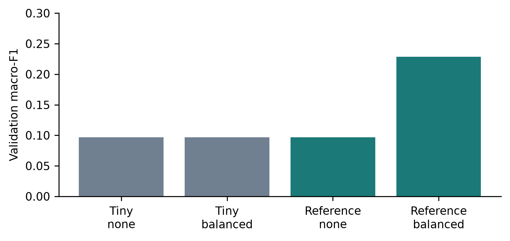

The tiny models and unweighted reference predicted only the majority class at epoch ten. Balanced loss helped the reference, but the tiny balanced model remained collapsed. These observations do not justify a universal weighting change. Synthetic results were retained in `evidence/learning_results.csv`, explicitly marked synthetic, and excluded from real-data efficacy claims.

### 5.4. New conventional validation controls

**Table 5.2. New real Gas validation measurements. RF: random forest; LR: logistic regression. FPR is normal records predicted as attacks under the configured code 0. Models and views were not tuned on test data.**

| Method | Features | Accuracy | Macro-F1 | FPR |
| --- | --- | --- | --- | --- |
| Majority | — | 0.630334 | 0.096657 | 0.000000 |
| RF | all | 0.714183 | 0.818609 | 0.443790 |
| LR | all | 0.723923 | 0.829630 | 0.421715 |
| RF | without time | 0.728046 | 0.843997 | 0.421797 |
| LR | without time | 0.723974 | 0.829657 | 0.421634 |
| RF | time only | 0.197176 | 0.176417 | 0.866896 |
| LR | time only | 0.089054 | 0.101405 | 0.992069 |

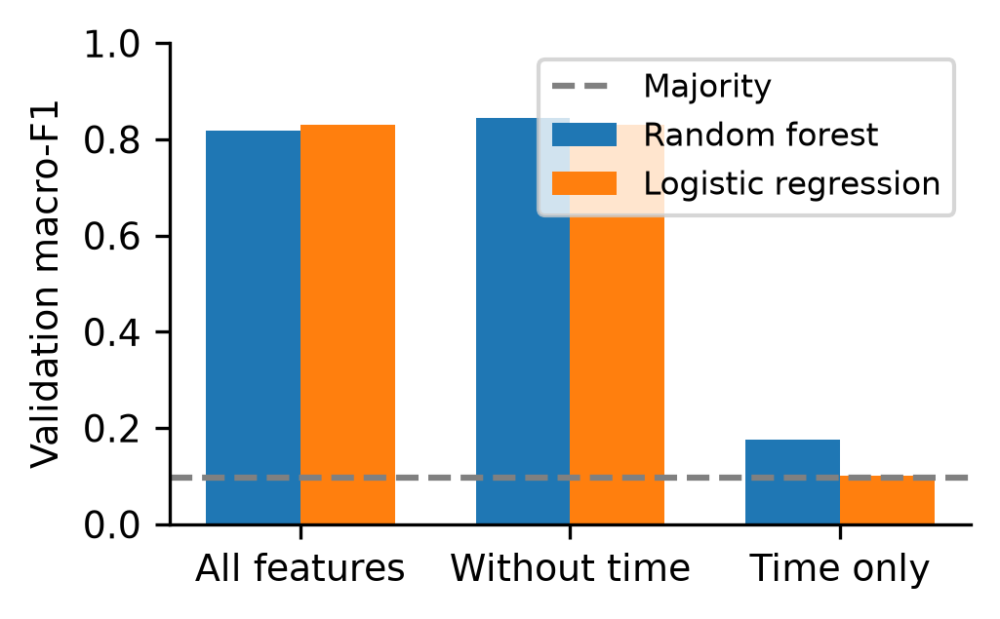

Random forest and logistic regression with all predictors obtained validation macro-F1 of 0.818609 and 0.829630, respectively. Without time, their scores were 0.843997 and 0.829657. Time-only controls obtained 0.176417 and 0.101405. These values are much higher than the short-budget balanced neural reference for the all-feature conventional controls. However, all-feature forest and logistic models falsely flagged 44.38% and 42.17% of configured normal validation records, respectively. Their high macro-F1 does not demonstrate an operationally acceptable detector. The evidence does not show a neural or NAS advantage. Removing time did not lower these two conventional validation scores, but does not establish freedom from operating-condition shortcuts or repeated-state dependence. Longer neural training and appropriate independent partitions remain necessary for any comparative conclusion.

### 5.5. Historical held-out verification

After the earlier validation comparison, two presets were restarted for ten epochs at seed 10042. These historical measurements were preserved and checked against saved predictions. The test set was not reused to select the new conventional controls.

**Table 5.3. Historical held-out Gas measurements, one split and one final seed. Timing is training plus validation, not full search time or total pipeline latency.**

| Measure | Tiny / none | Reference / balanced |
| --- | --- | --- |
| Accuracy | 0.630334 | 0.707792 |
| Macro precision | 0.078792 | 0.525883 |
| Macro recall | 0.125000 | 0.378023 |
| Macro-F1 | 0.096657 | 0.299371 |
| Weighted-F1 | 0.487410 | 0.592088 |
| Parameters | 172 | 5,128 |
| Predicted classes | 1 | 6 |
| Zero-recall classes | 7 | 2 |
| Training + validation (s) | 11.215265 | 14.605253 |

**Table 5.4. Historical held-out recall by verified class name and target code. The balanced reference missed CMRI (2) and MSCI (3) completely.**

| Code | Class | Control recall | Reference recall |
| --- | --- | --- | --- |
| 0 | Normal | 1.000000 | 0.999836 |
| 1 | NMRI | 0.000000 | 0.019892 |
| 2 | CMRI | 0.000000 | 0.000000 |
| 3 | MSCI | 0.000000 | 0.000000 |
| 4 | MPCI | 0.000000 | 0.006545 |
| 5 | MFCI | 0.000000 | 0.965217 |
| 6 | DoS | 0.000000 | 0.032698 |
| 7 | Recon | 0.000000 | 1.000000 |

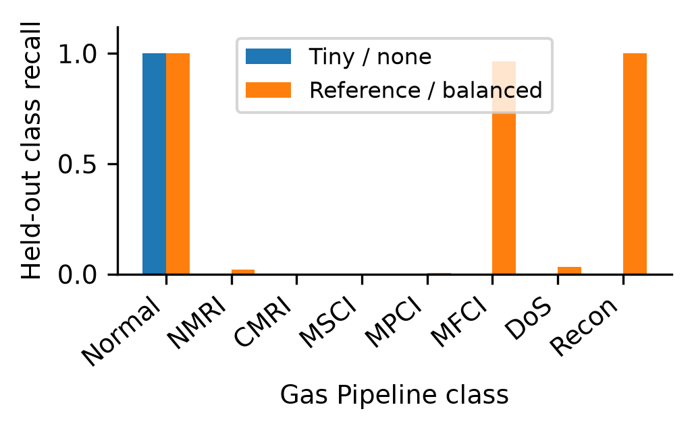

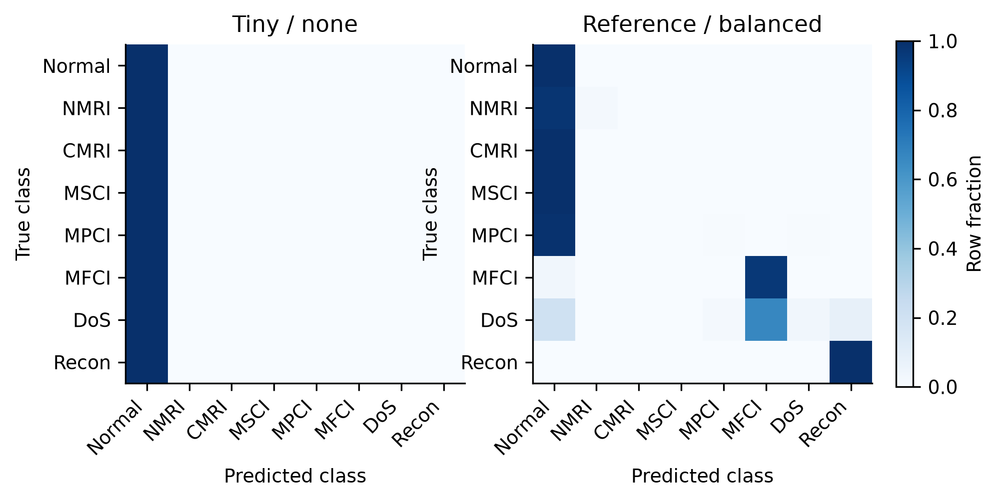

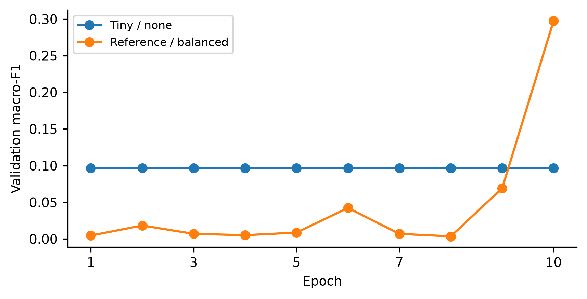

The balanced reference achieved held-out macro-F1 0.299371, accuracy 0.707792, and recall 0.378023. The tiny control achieved macro-F1 0.096657 and accuracy 0.630334. Their parameter counts were 5,128 and 172. The combined preset/loss change cannot attribute the test difference to one factor. CMRI (2) and MSCI (3) remained undetected; NMRI (1), MPCI (4), and DoS (6) had very low recall. A single final seed supports neither a confidence interval across independent runs nor a significance claim. The historical test observations are now development knowledge; any new modeling choices require a disciplined validation protocol and ideally an independent locked evaluation set.

### 5.6. Historical software and artifact verification

The revised CPU suite passed 71 tests in 7.98 seconds in the recorded run. Dependency consistency and Python compilation passed. Tests covered exact continued training for unweighted and weighted loss, search with the test file removed, train-fitted transforms, grouped and chronological splits, codec round trips, forward and backward shapes, maximization, resource caps, native scheduler replay, and tie-aware rankings. The added overlap test detected contradictory-label predictor matches and validation–test overlap.

A fresh artificial integration completed seven search paths, one final fixture evaluation, ranking diagnostics and report generation. Actual search epochs were 12, 6, 8, 2, 2, 12, and 12 for BPSO, reduced BPSO, halving BPSO, Hyperband, DEHB, random and surrogate, respectively. Unequal usage makes these execution checks unsuitable for an equal-compute comparison. All six checked metrics, including confusion matrices, matched 47 archived held-out prediction files within absolute tolerance $10^{-12}$. This proves internal consistency for those files, not real-world accuracy or absence of leakage.

## 6. Extended validation experiments

### 6.1. Scope and frozen protocol

At the authors' request, additional feasible experiments filled several earlier evidence gaps. A fixed protocol evaluated four hybrid presets across seeds 42, 43 and 44 at 3, 10 and 30 epochs; compared three normalization choices; added conventional MLP, CNN-only and GRU-only controls; and continued selected reference trajectories to 200 epochs. The neural extension comprised 27 trajectories through epoch 30 and four prespecified continuations. A separate state-grouped sensitivity study added three hybrid trajectories and six tabular fits. None evaluated a model on a new test partition.

The protocol was stored before its scores. Every training directory contained only training and validation arrays. Source hashes, row IDs, class vocabulary, weighting, optimizer, seeds and endpoints were recorded. All neural controls used balanced training-only weights, Adam at learning rate 0.001, batch size 256 and gradient clipping at norm 1. There was no validation-based endpoint stopping: each requested budget was completed exactly. Results below report observed validation performance, not new held-out accuracy.

The new random-split neural runs used an NVIDIA RTX 3050 Laptop GPU with 4 GB and CUDA 13.2. The state-grouped neural controls used CPU execution. Both used Python 3.14.4 and PyTorch 2.15.0. Device and row-distribution differences prevent treating a cross-split difference as a controlled causal leakage effect. Timing describes the actual sessions; no speedup or energy claim is derived from it.

### 6.2. Preset definitions and learning budgets

The small, reference and wide hybrids used CNN/GRU widths 8/16, 16/32 and 32/64. Each CNN used kernel 3, same padding, ReLU and pooling by 2. The GRU used a tanh post-activation and dropout 0.1. The stacked model used CNN16 followed by CNN32 with pooling by 1 in its second block, then GRU32. Width/depth settings formed conventional presets rather than a probability sample of the complete architecture space.

**Table 6.1. Complete four-preset column-L2 cohort. Values are validation macro-F1 means ± sample SD across three training seeds.**

| Preset | Epoch 3 F1 | Epoch 10 F1 | Epoch 30 F1 |
| --- | --- | --- | --- |
| Small | 0.0460 ± 0.0460 | 0.0794 ± 0.0632 | 0.1724 ± 0.0478 |
| Reference | 0.0243 ± 0.0094 | 0.1309 ± 0.1186 | 0.4267 ± 0.2074 |
| Wide | 0.0705 ± 0.0550 | 0.4912 ± 0.0715 | 0.7348 ± 0.0868 |
| Stacked | 0.0194 ± 0.0142 | 0.2903 ± 0.2629 | 0.4735 ± 0.1835 |

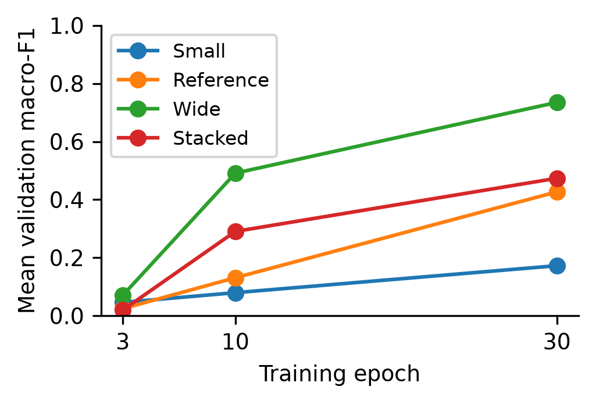

**Table 6.2. Within-seed early-to-30-epoch comparisons. Regret intervals preserve ambiguity among tied early winners.**

| Seed | Early epoch | Spearman | Kendall | Regret |
| --- | --- | --- | --- | --- |
| 42 | 3 | 0.9487 | 0.9129 | 0.0000 |
| 42 | 10 | 0.8000 | 0.6667 | 0.0000 |
| 43 | 3 | 0.3162 | 0.1826 | 0.0284 |
| 43 | 10 | 0.8000 | 0.6667 | 0.0000 |
| 44 | 3 | 0.2000 | 0.0000 | 0.0000 |
| 44 | 10 | 0.8000 | 0.6667 | 0.0000 |

The cohort supplied matched candidate identities at each budget. At epoch 10, selection regret to epoch 30 was zero for all three seeds and Spearman correlation was 0.8 in every seed. At epoch 3, only seed 43 incurred positive regret, 0.0284. This cohort therefore did not establish a severe early-winner selection problem. Undefined correlations and selection-boundary ambiguities remained explicit, and no significance test was inferred from four-point correlations. The study did not complete the prespecified 25-candidate diversity study or a 200-epoch full-cohort ranking measurement. Its ranking results were measured under column L2 only.

### 6.3. Normalization and conventional component baselines

Column L2 used training-column norms; row L2 normalized each record; Min–Max fitted its parameters using training only. All three views retained the original random-split row IDs and the same training-fitted numeric imputation. Validation values did not fit transform parameters.

**Table 6.3. Reference hybrid, 30 epochs. Macro-F1 gives mean ± sample SD; accuracy and normal FPR give three-seed means.**

| Scaling | Macro-F1 | Accuracy | FPR |
| --- | --- | --- | --- |
| Column L2 | 0.4267 ± 0.2074 | 0.3136 | 0.9442 |
| Min–Max | 0.7831 ± 0.0768 | 0.6550 | 0.5324 |
| Row L2 | 0.7190 ± 0.0390 | 0.6710 | 0.4934 |

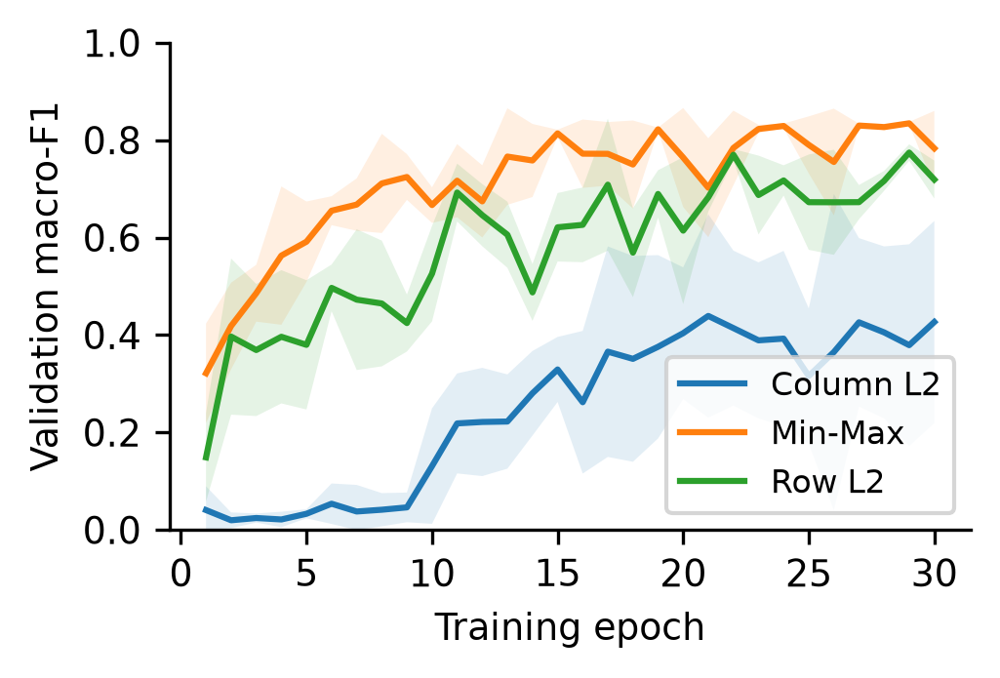

The mean reference macro-F1 was 0.4267 for column L2, 0.7190 for row L2 and 0.7831 for Min–Max. This is evidence that a conventional scaling decision materially affected the bounded experiment. It is not evidence that normalization is a novel search contribution or that one transform dominates across releases.

The MLP used fully connected widths 64 and 32 with ReLU and dropout 0.1 after its first layer. The CNN-only control used Conv1d16, kernel 3, same padding, ReLU and pooling by 2, then flattened its features into a 32-unit ReLU head and dropout 0.1. The GRU-only control processed the feature sequence with input size 1, hidden width 32, and a dropout/classification head. These conventional baselines had different capacities and readouts. They therefore supply practical controls, not pure one-factor removal ablations.

**Table 6.4. Min–Max neural controls at 30 epochs. Parameter counts are actual model counts.**

| Model | Macro-F1 | Accuracy | FPR | Params. |
| --- | --- | --- | --- | --- |
| MLP | 0.8325 ± 0.0012 | 0.7247 | 0.4217 | 4,072 |
| CNN | 0.8275 ± 0.0032 | 0.7233 | 0.4221 | 7,016 |
| GRU | 0.7510 ± 0.0709 | 0.6416 | 0.5469 | 3,624 |
| CNN–GRU | 0.7831 ± 0.0768 | 0.6550 | 0.5324 | 5,128 |

The MLP and CNN-only controls had higher mean validation macro-F1 than the reference hybrid at this budget. The reference's normal-class FPR was 53.24%, while the MLP's was 42.17%. Better macro-F1 therefore did not demonstrate acceptable operational false-alarm behavior. These controls do not establish a hybrid or NAS advantage.

**Table 6.5. Mean observed training-plus-validation elapsed seconds through epoch 30 on the GPU. Different costs mean matched epochs do not imply matched compute.**

| Model | Parameters | Train + validation (s) |
| --- | --- | --- |
| MLP | 4,072 | 13.17 |
| CNN | 7,016 | 14.23 |
| GRU | 3,624 | 16.73 |
| CNN–GRU | 5,128 | 20.14 |

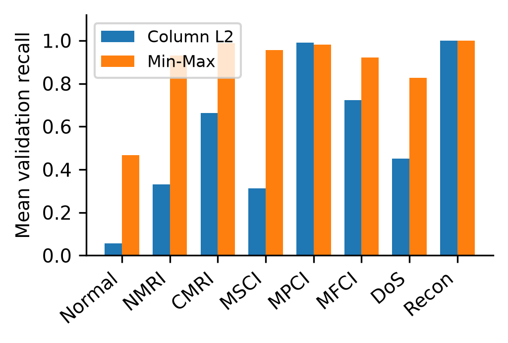

### 6.4. Prespecified long continuations

Column-L2 reference trajectories for all three seeds and the Min–Max reference at seed 42 continued from epoch 30 to 200. This plan was fixed before reading new measurements. The continuations preserved model/optimizer/RNG state; they were not independent final-seed restarts.

**Table 6.6. Actual 200-epoch validation endpoints. Min–Max has one continuation and therefore no seed-level SD.**

| Scaling | Seeds | Epochs | Macro-F1 | Accuracy |
| --- | --- | --- | --- | --- |
| Column L2 | 3 | 200 | 0.8390 ± 0.0084 | 0.7267 |
| Min–Max | 1 | 200 | 0.8407 (n=1) | 0.7264 |

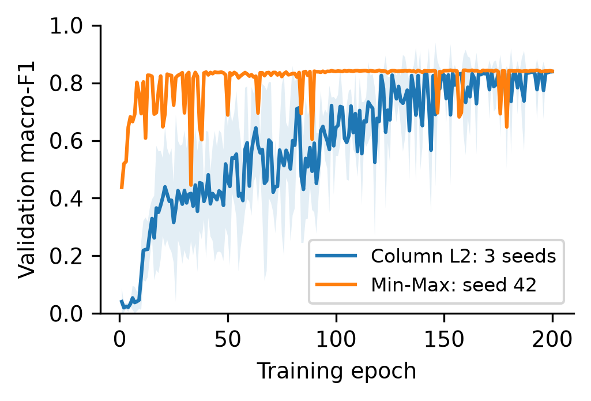

Column L2 reached mean validation macro-F1 0.8390 and the one Min–Max trajectory reached 0.8407. These measurements describe longer reference-training behavior. The subsequent fixed-endpoint study reports dedicated final-seed restarts separately. Full-budget BPSO search, a complete 200-epoch architecture cohort and independently locked evaluation remain outstanding.

### 6.5. State-grouped validation sensitivity

Predictor-only hashes of the 25 non-time features defined groups. Labels did not define the grouping. GroupShuffleSplit used seed 1729 to reserve 20% of groups and seed 1730 to split validation groups from the remainder. This produced 62,198 training, 14,462 validation and 20,359 reserved rows in 7,675 unique groups. Train–validation, train–reserved and validation–reserved intersections were all empty at the group level. All eight classes occurred in both training and validation.

Numeric imputation and Min–Max were fitted again on this split's training rows. The reserved partition had no exported model-input array and was not evaluated. Random forests used 100 trees and balanced class weights; logistic regression used balanced weights and training-fitted standard scaling; the reference hybrid used the same neural hyperparameters for 30 epochs on CPU. Each method used training seeds 42/43/44 on the same grouped split.

**Table 6.7. Actual class support in the state-grouped training and validation partitions. Group-based fractions do not enforce equal class proportions or row fractions.**

| Code | Class | Train | Validation |
| --- | --- | --- | --- |
| 0 | Normal | 36,140 | 8,589 |
| 1 | NMRI | 1,630 | 505 |
| 2 | CMRI | 10,985 | 2,222 |
| 3 | MSCI | 444 | 187 |
| 4 | MPCI | 4,871 | 2,456 |
| 5 | MFCI | 396 | 86 |
| 6 | DoS | 1,118 | 316 |
| 7 | Recon | 6,614 | 101 |

**Table 6.8. State-grouped validation results, three training seeds. Row counts and class proportions differ from the original random split.**

| Model | Macro-F1 | Accuracy | FPR |
| --- | --- | --- | --- |
| Random forest | 0.8372 ± 0.0010 | 0.8480 | 0.1885 |
| Logistic | 0.8018 ± 0.0000 | 0.6806 | 0.4902 |
| CNN–GRU | 0.7559 ± 0.0804 | 0.6077 | 0.6158 |

The hybrid mean was 0.7559. Zero shared exact non-time states strengthens this internal sensitivity check, but near-duplicate states and shared capture conditions may remain. The grouping is not equivalent to a capture/session split, temporal holdout or independent release. No causal claim about the amount of leakage or a prospective deployment score follows from these results.

### 6.6. Verification and reproducibility

The expanded CPU suite passed 74 tests, including exact continuation and test-array absence for all three newly added neural families. The new model factory leaves decoded NAS candidates on the existing hybrid path. The added controls remain outside the binary search space. The asset builder checked all 94 new measurement records against their saved validation predictions and retained prediction hashes. Training seeds and continuation endpoints were not counted as independent dataset replicates.

Run the exact studies from the repository root, using fresh output directories and an available CUDA device for the first command:

```bash
python -m scripts.extend_research_evidence --device cuda --output results/research_extension
python -m scripts.state_grouped_validation --output results/state_grouped_validation
python -m scripts.build_extended_assets
```

With the bundled summaries, regenerate these figures and tables without original run directories:

```bash
python -m scripts.build_extended_assets --snapshot
python3 scripts/compile_submission.py
```

The frozen settings are in `configs/research_extension.yaml`; individual measurements, protocols, curves and environments are included in `evidence/extended_*` and `evidence/grouped_*`. Full checkpoints remain in the local result directories. The remaining scientific actions should be read against this completed extension rather than the earlier short-budget-only status.

## 7. Fixed-endpoint reference testing and current verification

### 7.1. Protocol and separation from model selection

After completing the validation studies, the CNN16–GRU32 reference was fixed with training-fitted Min–Max scaling, balanced cross entropy, Adam at learning rate 0.001, batch size 256, dropout 0.1 and clipping norm 1. The final-evaluation protocol was recorded before generating its test predictions. It specified independent initializations at seeds 10042, 10043 and 10044, exactly 200 epochs, and no selection of an intermediate checkpoint from validation or test peaks. The data were prepared in a fresh directory, and their source checksums and partition row identities were verified against the original preparation.

These are fixed-reference experiments rather than models selected by a full BPSO run. Earlier test scores were already known, so the historical split cannot serve as a new blinded evaluation. Changing normalization and training duration together also prevents attributing differences from the earlier ten-epoch reference to one factor.

### 7.2. Measured test results

**Table 7.1. Fixed 200-epoch reference evaluation on the existing random-stratified split. Validation and test F1 are macro-averages.**

| Seed | Val. F1 | Test acc. | Test F1 | FPR |
| --- | --- | --- | --- | --- |
| 10042 | 0.8416 | 0.7242 | 0.8456 | 0.4268 |
| 10043 | 0.8423 | 0.7236 | 0.8441 | 0.4271 |
| 10044 | 0.8436 | 0.7243 | 0.8465 | 0.4271 |

**Table 7.2. Mean final test precision, recall and F1 across training seeds; support is the fixed test class count.**

| Class | Precision | Recall | F1 | Support |
| --- | --- | --- | --- | --- |
| Normal | 0.9847 | 0.5730 | 0.7244 | 12,231 |
| NMRI | 0.0944 | 0.9439 | 0.1717 | 553 |
| CMRI | 0.9374 | 0.9845 | 0.9604 | 3,093 |
| MSCI | 0.9677 | 0.9615 | 0.9646 | 156 |
| MPCI | 0.9810 | 0.9804 | 0.9807 | 1,528 |
| MFCI | 1.0000 | 0.9652 | 0.9823 | 115 |
| DoS | 0.9944 | 0.9646 | 0.9792 | 367 |
| Recon | 1.0000 | 1.0000 | 1.0000 | 1,361 |

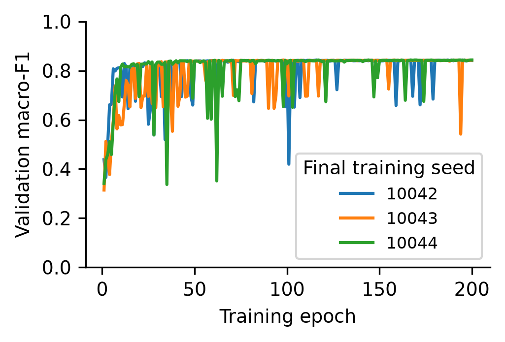

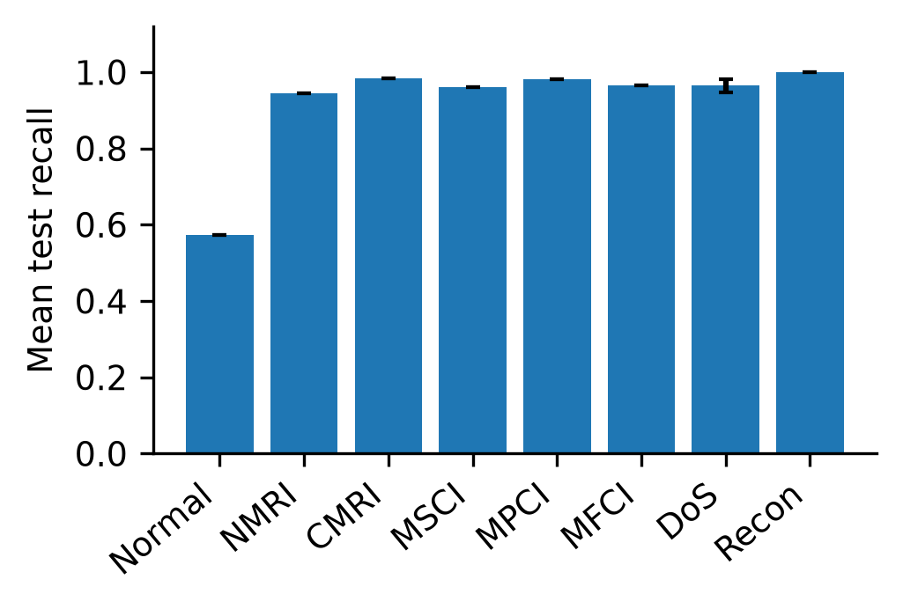

Mean test macro-F1 was 0.8454 with sample SD 0.0012; mean accuracy was 0.7240 and mean normal-class FPR was 0.4270. All saved prediction archives independently reproduced their classification metrics and confusion matrices. Variation across seeds describes optimization on one fixed partition, not uncertainty across independent captures or releases. Class recall and false alarms must accompany aggregate accuracy when assessing detector usefulness.

Normal recall was approximately 0.5730 and NMRI precision was approximately 0.0944, despite NMRI recall of 0.9439. The detector falsely flagged about 42.70% of normal test records, predominantly as NMRI. This explains why strong recall across attack classes and a macro-F1 near 0.845 did not translate into similarly high accuracy or an acceptable false-alarm burden. The study retained the fixed protocol and did not tune settings after observing these test errors.

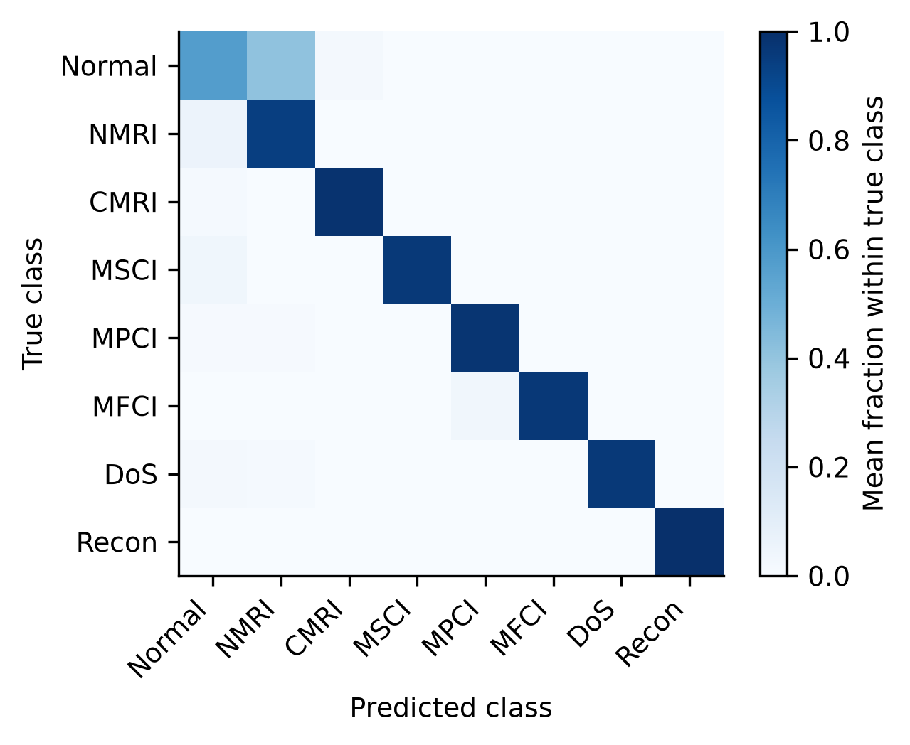

#### 7.2.1. Validation-Selected False-Alarm Correction

The balanced-loss reference was followed by an exploratory comparison of unweighted and square-root inverse-frequency weighting. Architecture, preprocessing, optimizer and the 200-epoch endpoint were held fixed. Candidate training used seed 42 and training/validation arrays only. Neither candidate met the initial 1% validation false-alarm target with at least 90% attack detection. Before generating new test predictions, the false-alarm limit was revised to 3%, retaining the detection constraint. Square-root weighting was selected by validation macro-F1 (0.8552 versus 0.8480 for unweighted loss).

The exploratory validation-selected square-root weighting correction reduced mean normal test false alarms from 42.70% to 1.90%, with accuracy 95.44%, macro-F1 0.8551 and attack detection 90.96%. However, NMRI recall fell from 94.39% to 0.54%. This is a false-alarm versus attack-sensitivity trade-off, not a complete detector-quality solution; the original 1% false-alarm target remains unmet. Independent evaluation is still required.
The selected setting was evaluated at paired final seeds 10042, 10043 and 10044, each trained for exactly 200 epochs on GPU. These results describe a conventional loss correction on the historical split. The revised target is exploratory, and no test-driven threshold or endpoint selection was performed after these new predictions.

#### 7.2.2. Dedicated NMRI Specialist

A subsequent validation-selected normal/NMRI specialist increased mean NMRI test recall from 0.54% to 16.82%, while normal false alarms rose from 1.90% to 2.60%. Accuracy was 95.46%, macro-F1 0.8854, and overall attack detection 92.23%. This improves the observed trade-off, but most NMRI attacks are still missed. The same training-fitted specialist was shared across three hybrid seeds; these are not three independent specialist fits or independent-dataset replicates.

The specialist was trained on normal/NMRI training rows and only reconsidered normal or NMRI hybrid predictions. Extra Trees, histogram gradient boosting and a GPU-trained neural specialist were compared on validation. No tested method achieved 50% NMRI recall below 5% false alarms. An explicitly revised exploratory criterion selected histogram gradient boosting by validation macro-F1. It required under 3% false alarms, at least 10% NMRI recall and 90% overall attack detection. All three validation thresholds were fixed before new test predictions. Training-only analysis found that 1,374 of 1,657 NMRI records shared their non-time predictor state with normal records. The audit leaves out duration, so it cannot establish that the full feature set is unable to distinguish the classes.

**Table 7.3. Observed test operating points. NMRI denotes class recall, and FPR is the normal false-positive rate. Means use three hybrid seeds; the specialist is shared.**

| Setting | FPR (%) | NMRI (%) | Acc. (%) | F1 |
| --- | --- | --- | --- | --- |
| Balanced | 42.70 | 94.39 | 72.40 | 0.8454 |
| Sqrt loss | 1.90 | 0.54 | 95.44 | 0.8551 |
| Specialist | 2.60 | 16.82 | 95.46 | 0.8854 |

### 7.3. Earlier workflow verification

At that study stage, the CPU and CUDA-configured suites each passed 74 tests. Device-aware tests exercised CUDA, while the three component-continuation tests explicitly used CPU. Compute-limited integration checks exercised preparation, fixed-model training and testing, architecture search, diagnostics, all seven search controls, reporting and search resume for real Gas data and three synthetic profiles. Synthetic profiles remained marked as artificial and were excluded from research performance tables. The 94 earlier validation measurement records were rechecked against saved predictions and hashes. Environment dependency consistency and Python compilation also passed.

## 8. Computational Efficiency of Adaptive Multi-Fidelity BPSO

### 8.1. Diagnosis and experimental correction

The earlier matched-wall study gave each method 30 seconds with high iteration ceilings and no target-stop rule. It therefore measured quality with the same compute allocation rather than the computation saved in reaching a common quality. BPSO and UA each consumed about 28.76 GPU seconds. Predictor calls cost about 0.10 seconds; the predictor's archive cost 403.82 GPU seconds. Continuation and decoded-architecture deduplication were already functioning. Execution overhead came from per-example batching, scalar synchronization and dense validation. Repeated model/checkpoint loading added further overhead.

We use separate fixed-quality and fixed-compute experiments. For target $\tau$, $T(\tau)$ is the cumulative measured GPU elapsed time to the first actual 30-epoch candidate reaching validation macro-F1 $\tau$. Misses are right-censored at the compute limit $B$. Restricted completion time is $\min(T,B)$, and every seed remains in the comparison. Fixed-compute experiments compare the best actual 30-epoch scores at common GPU limits. They cannot by themselves prove cost saving.

GPU elapsed time follows the original convention of synchronized training/validation elapsed time. It includes host stalls within those intervals, so it measures neither pure kernel time nor energy. Search wall time also includes predictor, scheduling, checkpoint and import overhead. GPU caps are checked after completed epochs. The final epoch can therefore overrun. Score comparisons under a strict compute limit exclude terminal observations beyond the stated limit.

### 8.2. Engineering and candidate policy

Vectorized batches preserve the original sampler and RNG order. Data/resident-tensor caches with fixed capacity reduce loading and transfers. A one-model cache keyed by trial directory avoids redundant reconstruction and optimizer loading during immediate continuation. FP32 loss-scalar synchronization is deferred. Validation runs at epochs 3/10/30, while checkpoints still commit every epoch. Across three development architectures, cumulative GPU elapsed time fell from 25.059 to 20.182 seconds (19.47%). Final parameter tensors were identical. These fixed-order, one-pass profiles have limited precision. We rejected automatic mixed precision (AMP) because it changed outcomes beyond the 0.01 development tolerance. Batch sizes and the search space stayed unchanged.

The candidate starts by probing two particles. It then selects continuations dynamically, without a fixed halving quota. At most two promotions can occur before a new probe is forced. Its priority is

$$
\begin{aligned}
P(a)={}&\widehat f_{30}(a)+\beta u(a)\\
&-\lambda\frac{\widehat c(a)}{\operatorname{median}_{z\in\mathcal A}\widehat c(z)},
\end{aligned}
$$

where $u(a)$ is the calibrated prediction radius for architecture $a$, $\beta$ weights the uncertainty bonus and $\lambda$ weights the median-normalized remaining-compute cost. The cost estimate $\widehat c$ accounts separately for remaining training epochs and validation passes. A candidate stops if its full prediction upper bound falls below the best observed 30-epoch score plus 0.01. Low initial F1 alone does not stop it. Only actual terminal scores update BPSO attractors, and every predictive variant retains the same 20% diversity restart.

Existing logs are used to refit the sparse, timing-invariant forest. Architecture-disjoint development replay on IDs 0–11 fixed $\beta=0.1$, $\lambda=0.2$ before the new search seeds. The split-conformal residual construction [10] retains calibration IDs 12–17 and held-out IDs 18–24. Nominal 80% intervals covered 13/14 held-out observations at epoch 3 and 14/14 at epoch 10. Their mean widths were 0.573 and 0.481, respectively. These broad intervals do not guarantee useful calibration under adaptive proposal shift. No new GPU archive was collected, but historical collection cost is still charged.

### 8.3. Measured quality, cost and ablations

Nine methods/ablations used seeds 601–603 and the same 8192/4096 training/validation view with all eight classes. They used original training-fitted Min–Max preprocessing, balanced loss, FP32 runtime and a maximum fidelity of 30. The initial 8-GPU-second pilot executed independent targets 0.4/0.5/0.6 and fixed-compute runs. BPSO missed target 0.6 in all three pilot runs and SH reached it only once, so we extended the target-0.6 and fixed-compute experiments to 20 GPU seconds. The declared exploratory continuation retained all methods/seeds/coefficients, resumed saved optimizer/RNG states, and charged every previously spent epoch, GPU second and wall second, including checkpoint-import overhead. It is not a new independent replication.

**Table 8.1. Target 0.6: actual mean GPU elapsed time to target or cap, with all three seeds retained. Misses are censored rather than excluded. Scores are actual terminal validation macro-F1. Archive cost is separate.**

| Method | GPU s | F1 | Saving (%) | Hits |
| --- | --- | --- | --- | --- |
| BPSO | 17.01 | 0.264 | 0.0 | 1/3 |
| BPSO-SH | 12.10 | 0.497 | 28.8 | 2/3 |
| DEHB | 6.78 | 0.703 | 60.2 | 3/3 |
| Fixed prediction | 11.94 | 0.529 | 29.8 | 2/3 |
| Hyperband | 17.88 | 0.502 | -5.1 | 1/3 |
| Dynamic prediction | 12.98 | 0.507 | 23.7 | 2/3 |
| Full UA | 12.80 | 0.539 | 24.7 | 2/3 |
| UA without cost | 13.03 | 0.507 | 23.4 | 2/3 |
| UA without bonus | 12.80 | 0.539 | 24.7 | 2/3 |

Full UA used 12.803 GPU seconds versus 17.008 for BPSO: a 24.72% online reduction, just below the 25% engineering goal. It attained 2/3 targets versus 1/3 for BPSO. SH used 12.103 seconds with 2/3 hits, so full UA was 5.78% slower. DEHB used 6.776 seconds, attained 3/3 targets and saved 60.16% versus BPSO. These comparisons cover three seeds over finite horizons and do not establish statistical superiority. The restricted-time saving of 25.14% is a different censored estimand and cannot be used to claim the 25% goal was met.

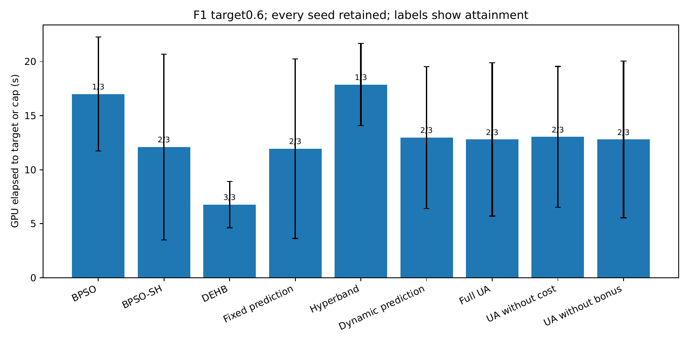

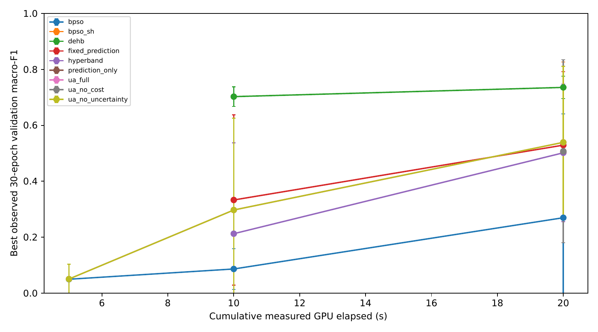

With a fixed 20-second compute allocation, mean validation macro-F1 was 0.5391 for full UA, 0.2696 for BPSO, 0.5030 for SH and 0.7356 for DEHB. The full-method gap to DEHB was 0.1965, exceeding the 0.02 preservation margin. Removing the uncertainty bonus changed no terminal winner scores. Removing cost reduced mean F1 by 0.0320, but cost-aware UA still did not beat SH on target-time cost. Fixed-quota prediction used 11.940 target-or-cap GPU seconds and F1 0.5291; dynamic prediction used 12.978 and 0.5071. The more complex allocation is not independently supported as an improvement.

### 8.4. Total cost, final models and limitations

Charging the historical archive gives 416.622 GPU seconds for one full-UA quality search versus 17.008 for BPSO: no net single-search saving remains. The fit/calibration subset alone cost 308.386 historical GPU seconds. Smaller-log CPU refits reduced that attributable subset but increased held-out point-prediction error; they were not substituted into the frozen benchmark. Historical reuse is not free computation. Online calibration was not claimed from a few adaptively selected terminal observations.

All methods' fixed-compute architecture choices were frozen before final testing, using dedicated seed 1601 and 30 epochs. The previously examined historical test is not blind independent data. BPSO test macro-F1 was 0.2733, with normal FPR 0.8038. BPSO-SH test macro-F1 was 0.5759, with normal FPR 0.6180; for Full UA, these values were 0.3100 and 0.9442, respectively. DEHB test macro-F1 was 0.6859, with normal FPR 0.7549. We retain precision, attack recalls, confusion matrices, parameters and measured inference latency. Generalization is limited by one final training seed and shared historical rows. The existing conventional MLP/CNN/GRU/reference results provide context.

At the preceding study stage, the regression suite passed 105 CPU tests and 50 targeted CUDA tests. We re-scored saved validation/test predictions and checked epoch ledgers.

DEHB is the strongest baseline. SH offers a simpler BPSO alternative and lower target-time cost than full UA. The runtime optimizations were verified. Novelty and superior uncertainty-aware allocation are not established. The initial pilot (Section 8.3) and the archive-free online extension (Section 8.5) are reported separately. More search/final seeds, full-training studies, independently validated calibration and independent captures are still needed.

### 8.5. Archive-free online extension

The archive-dependent result motivated a fresh experiment with separate bounds. Its implementation begins as ordinary BPSO–SH, with the same proposals, quotas and tie handling. It captures architecture, learning-curve prefix and measured incremental-cost features at epochs 3 and 10, attaching a terminal label only after actual epoch 30 training. No offline bundle, historical target, cross-method checkpoint or separately trained GPU archive enters this variant. Candidate maturation is charged to ordinary search work.

A fixed architecture hash assigns fit/calibration/check roles with expected proportions 50/20/30%. CPU random forests use 24 trees of maximum depth 4. All current query architectures are excluded from fitting and calibration, and check forecasts are frozen before their terminal labels arrive. At least six fit, four calibration and four prequential check architectures per rung are required. The point gate requires MAE$\leq0.08$. MAE must be at least 10% lower than that of current-F1 prediction. The absolute MAE improvement over that baseline must also be at least 0.005. The gate also requires Spearman$\geq0.3$. For uncertainty modes, empirical coverage must be at least 0.75 for nominal 80% intervals, with mean width at most 0.3. Current intervals must also meet the width limit. These are conservative engineering checks, not a proof of calibration under adaptive sampling.

The interval uses a separate calibration quantile of absolute residual divided by forest dispersion (floor 0.02). When useful, ranking follows the earlier priority equation. It uses generic frozen values $\beta=0.1$ and $\lambda=0.05$, with median-normalized measured remaining cost. Prediction-only sets both coefficients to zero; uncertainty-only sets $\lambda=0$. If a gate fails, ordinary SH ranking remains in use. Swarm bests update only from actual terminal observations. We retain fixed SH quotas to isolate ranking, without claiming a new BPSO equation or algorithmic novelty.

### 8.6. Fresh end-to-end comparison

The 42 new runs use seeds 601–603 and seven methods. They include target 0.6 and fixed 20-GPU-second phases. Dataset rows, eight labels, preprocessing, architecture space, FP32 execution and 3/10/30 fidelities match the preceding 20-second experiment. A 50-second wall safety cap also applies. Methods run serially in a seeded permutation, without importing earlier checkpoints. Misses remain censored. Strict-horizon quality excludes terminal evaluations beyond the cap, while actual resource consumption includes epoch-boundary overruns. Timing follows the existing synchronized elapsed convention.

**Table 8.2. Fresh target 0.6 runs, means across three search seeds. GPU seconds are measured; archive cost is charged to a standalone search. All misses are retained. Hits count actual terminal targets before the strict horizon.**

| Method | Online GPU | Archive | Total GPU | F1 | Hits |
| --- | --- | --- | --- | --- | --- |
| BPSO | 16.824 | 0.00 | 16.824 | 0.3054 | 1/3 |
| BPSO + SH | 12.004 | 0.00 | 12.004 | 0.4971 | 2/3 |
| DEHB | 6.778 | 0.00 | 6.778 | 0.7026 | 3/3 |
| Offline UA | 12.631 | 403.82 | 416.450 | 0.5391 | 2/3 |
| Online prediction | 11.919 | 0.00 | 11.919 | 0.4971 | 2/3 |
| Online + uncertainty | 11.950 | 0.00 | 11.950 | 0.4971 | 2/3 |
| Archive-free full | 11.947 | 0.00 | 11.947 | 0.4971 | 2/3 |

Archive-free full consumed 11.947 GPU seconds versus 16.824 for BPSO, a 28.99% total reduction, with 2/3 versus 1/3 target attainment. Terminal validation macro-F1 means were 0.4971 and 0.3054, respectively. SH used 12.004 seconds. Its winner scores matched those of the archive-free variants. The small 0.47% timing difference does not establish an advantage over SH. DEHB used 6.778 seconds and reached 3/3 targets. Removing the archive lowers standalone total cost relative to offline UA (416.450 seconds), but the online component itself must earn its cost.

Across the 18 matched online trials, predictive promotion activated 0 times and CPU fitting ran 0 times. Thus the new modes effectively executed SH in this short-horizon study. Their ablations do not establish any benefit from uncertainty or cost ranking. External archive cost is zero. This does not demonstrate an online-learning advantage. CPU preparation ranged 0.0017–0.0078 seconds per run and is included in search wall time.

With a fixed 20-second compute allocation, archive-free full preserved SH scores but trailed offline UA by 0.0361 and DEHB by 0.2325 absolute macro-F1. Both exceed the 0.02 engineering preservation margin; competitive quality against the strongest baseline was not maintained.

**Table 8.3. Fresh fixed 20-GPU-second comparison. F1 is the best genuinely evaluated 30-epoch validation macro-F1, mean (sample SD). Epoch counts and actual GPU elapsed time include charged incremental work.**

| Method | Terminal F1 (SD) | Epochs | GPU s |
| --- | --- | --- | --- |
| BPSO | 0.2696 (0.3715) | 178.7 | 20.040 |
| BPSO + SH | 0.5030 (0.3231) | 138.3 | 20.088 |
| DEHB | 0.7356 (0.0402) | 195.0 | 20.044 |
| Offline UA | 0.5391 (0.2719) | 205.0 | 20.201 |
| Online prediction | 0.5030 (0.3231) | 137.3 | 20.086 |
| Online + uncertainty | 0.5030 (0.3231) | 137.3 | 20.089 |
| Archive-free full | 0.5030 (0.3231) | 137.7 | 20.080 |

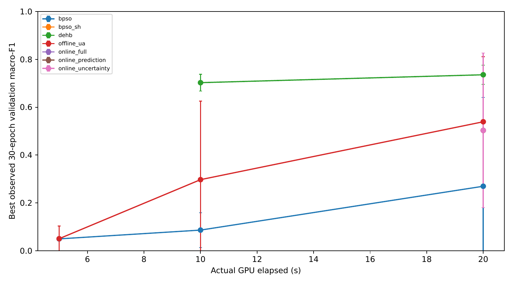

The full archive is charged once for a reusable multi-search campaign in the accompanying CSV, rather than once per seed. Offline CPU development preparation is not fully isolated. The recorded archive wall time of 420.722 seconds is therefore only a lower bound for full offline wall preparation. We record online CPU fitting/inference and scheduler costs separately. All saved validation predictions were independently re-scored, and epoch/GPU ledgers and architecture-disjoint feature/predictor identities were verified. The expanded suite passed 110 CPU and 55 targeted CUDA-configured tests.

The separate seed 601 diagnostic used 120.061 GPU seconds and 128.449 wall seconds. It matured 16 distinct terminal architectures, performed 1 CPU fit and applied prediction at 0 promotion decisions. Preparation consumed 0.0475 CPU wall seconds. Prediction was blocked 32 times by too few fit or calibration architectures and once by too few out-of-time check architectures. This is a cold-start diagnostic, not a matched performance comparison.

No new final detector test was executed in this extension. The preceding historical test results are retained. The evidence supports removing an uneconomic archive and using SH fallback; it does not support superior online uncertainty-aware allocation. DEHB remains the strongest baseline, with SH the simpler BPSO alternative. Stronger conclusions about online prediction would require more seeds, a longer matched compute horizon, useful online calibration and independent data.

## 9. Fairness, ablations, and missing evidence

### 9.1. Compute accounting and limitations

An epoch cap bounds completed training passes, not FLOPs: widths, sequence lengths, repairs, and batch sizes change cost. Search time includes scheduler, cache access, model construction, training/validation and I/O; final training, preprocessing and inference are separate. Time limits are checked at epoch boundaries and may overshoot by an epoch plus I/O. The evaluator reserves a full incremental promotion and can stop with unused resources. Fixed BPSO generation limits and caches can also underuse a cap. Equal caps therefore do not imply equal consumption. Report both actual usage and the selected candidate's fidelity. If a run stops before any maximum-fidelity result, its highest-fidelity fallback must be labelled incomplete rather than treated as a completed common-fidelity comparison.

Synchronized GPU seconds measure elapsed occupancy, not energy or kernel-active time. The later FP32 profiles and target-or-cap comparisons quantify elapsed-time reductions only in their tested settings; they do not measure IoT energy savings or hardware-level acceleration. Dense one-hot preprocessing and large candidates can exceed memory on small devices. Numerical failures are recorded; unexpected exceptions propagate. Interrupted partial-epoch work and a hard kill between individually atomic checkpoint/JSON/ledger writes can leave accounting gaps. Experiment directories must not be shared by concurrent processes. Cross-device exact floating-point equivalence is not guaranteed by deterministic settings.

### 9.2. Ranking protocol: implemented, not completed at research scale

The configured study samples 25 unique, diverse canonical phenotypes using greedy max-min Hamming spread, holds them fixed across seeds 42/43/44, and evaluates all at 3, 10 and 30 epochs. Measures include Spearman and Kendall correlation, top-$k$ overlap, elimination and regret

$$
R_{b\to B}=\max_a f_B(a)-f_B(\arg\max_a f_b(a)).
$$

Tied early winners can produce a regret interval. Ties crossing selection boundaries yield null overlap/elimination; index-based tie-breaking is only descriptive. Constant scores have undefined rank correlations. Candidate-index rank changes in saved class-learning CSVs retain deterministic tie-breaking and should not be interpreted as identifiable rank reversals through ties.

The default 200-epoch continuation selects a top shortlist, uniformly sampled early-rejected candidates, and median/worst examples. This subset is selected and cannot identify full-cohort 200-epoch regret or elimination. Setting the shortlist to the complete cohort removes that censoring if all jobs succeed. The two-candidate smoke diagnostic had tied macro-F1 values; it did not establish ranking instability. The four-preset study did not implement or validate a new confidence-aware policy; the later predictive allocation experiments are reported in the computational-efficiency chapter.

| Study / claim | Evidence status | Required next action |
| --- | --- | --- |
| Conventional controls | Initial controls and repeated state-grouped controls completed | Independent release and locked evaluation; do not claim held-out superiority |
| Loss and architecture | Repeated hybrid/MLP/CNN/GRU validation controls completed | Separate width/kernel/pool/dropout; repeat independent search and locked final evaluation |
| Low-fidelity rankings | Four-preset, three-seed 3/10/30 study completed | Full diverse cohort and adequate training protocols |
| Long-training ranking | Four reference continuations completed; full cohort missing | Train all candidates if making population-level claims |
| Search efficiency | FP32 profiles and compute-limited method comparisons completed; online predictive promotion inactive | Full-scale matched-resource comparisons, utilization, failures and common final endpoints |
| Additional established methods | Seven paths implemented; compute-limited BPSO, SH, Hyperband and DEHB comparisons completed | Extend the comparisons to full scale; consider BOHB for a new allocator claim |
| Normalization / repairs | Three scaling choices evaluated across seeds | Padding-repair versus valid-only space; repeat on independent data |
| Time and split policy | Semantics verified; zero-overlap exact-state grouping evaluated | Actual capture timestamps/order, session groups and independent release |
| Dataset generality | Original Gas only | Acquire approved original ToN-IoT/Bot-IoT/SWaT releases, schemas and licenses |
| Novel optimizer | Not established | Identify residual limitation, implement specific mechanism, review its prior art, compare under equal compute limits |
| Statistical superiority | Missing independent repeated searches | Prespecify paired seed analysis, effect sizes, multiplicity and power; avoid epoch-level pseudo-replication |

### 9.3. Scope of the reported results

The completed results cover the four-preset validation cohort, normalization and component controls, selected long continuations, grouped sensitivity checks, three fixed-reference final evaluations, false-alarm and NMRI follow-ups, runtime profiles and compute-limited search comparisons. Full-length BPSO winner results, full-scale matched-resource comparisons, the complete 25-candidate long-training cohort, independent-release testing and original ToN-IoT/Bot-IoT/SWaT benchmarks remain outstanding. The bounded search studies and inactive online gates do not establish superior uncertainty-aware allocation.

## 10. Experimental reproducibility

Repeatability was supported by recording dataset identity, feature order, partition rows, training-fitted transforms, class weights, model settings, random seeds and fixed endpoints. Validation experiments shared candidate identities across seeds 42, 43 and 44. Final-reference testing used independent restarts at seeds 10042, 10043 and 10044 after exactly 200 epochs. Checkpoint continuation preserved optimizer and random-number state. Saved predictions allowed the reported metrics to be recomputed independently. Repeated seeds describe training variability on fixed data; new releases and capture-aware partitions remain necessary for broader generalization claims.

## 11. Conclusion and future work

This project developed a reproducible framework for automated hybrid intrusion detection and evaluated how training duration, preprocessing and model choices affect its evidence. Training-only transforms, validation-only candidate fitness and fixed-endpoint testing provided a consistent progression from data preparation to evaluation. The completed workflow checks and prediction audits support the implemented behavior within the tested cases.

The experiments show that fitness from short training runs must be interpreted in the context of ordinary learning choices. At 30 epochs, Min–Max normalization yielded reference validation macro-F1 0.7831, compared with 0.4267 for column L2. The epoch-10 winning preset remained the winner at epoch 30 for each of the three seeds in the four-preset cohort. Conventional MLP and CNN controls also performed strongly, so hybrid complexity alone did not establish a performance advantage. The grouped sensitivity study further showed the importance of examining repeated operating states when interpreting random-split results.

Three separately initialized reference models achieved mean test macro-F1 0.8454 with sample SD 0.0012 at the fixed 200-epoch endpoint. These results extend the project beyond execution checks with short training runs while remaining specific to the fixed reference and historical partition. Class recall and normal-class false alarms remain necessary measures of detector usefulness. The work supports an academic implementation and empirical evaluation contribution; it does not establish a new optimizer or superior uncertainty-aware allocation.

The archive-free follow-up removed separately trained GPU predictor observations and reduced total target-or-cap GPU cost by 28.99% relative to BPSO. The short matched searches remained in SH fallback. This saving therefore does not establish a contribution from online prediction or uncertainty. DEHB was the strongest baseline. The contribution of this work is a reproducible framework and a measured comparison of search methods under a fixed compute allocation. It does not show that uncertainty-aware allocation outperforms existing methods.

The exploratory square-root weighting correction was selected on validation data and reduced mean normal test false alarms from 42.70% to 1.90%. Accuracy reached 95.44%, macro-F1 0.8551 and attack detection 90.96%, while NMRI recall dropped from 94.39% to 0.54%. This trades attack sensitivity for fewer false alarms. It is not a complete detector-quality solution, and the original 1% false-alarm target remains unmet.

A subsequent normal/NMRI specialist was selected on validation data. Mean NMRI test recall rose from 0.54% to 16.82%, while normal false alarms increased from 1.90% to 2.60%. Accuracy was 95.46%, macro-F1 0.8854 and overall attack detection 92.23%. The observed trade-off improved, although most NMRI attacks are still missed. One training-fitted specialist served all three hybrid seeds. These runs are not three independent specialist fits or independent-dataset replicates.

Future work should extend established-method comparisons to full scale under matched actual resources, expand the architecture cohort, and evaluate on independently collected or capture-separated data. Such experiments would determine whether a residual allocation problem remains after adequate training and whether any search-policy change improves practical intrusion detection.

## A. Execution instructions and artifact organization

### A.1. Source layout and fixes

`src/data` supplies explicit profiles, file checksums, splitting and transforms; `src/models` supplies shape-safe blocks; `src/training` supplies loss and cumulative checkpoints; `src/optimization` supplies codec, shared evaluator and schedules; `src/evaluation` supplies metrics, rankings and exports. Configurations inherit via `extends`; exact resolved settings are saved per run. Debug and synthetic configurations are explicitly separated from original-data configurations.

Earlier local review edits were present when this audit began and were preserved. They included unmatched-pattern rejection, canonical-path deduplication, synthetic provenance in the main smoke workflow, and tie/censoring corrections. The earlier review extended overlap diagnostics and corrected a remaining artificial CLI validation configuration to set `synthetic: true`. The earlier scripts supplied reproducible conventional controls, prediction/inventory auditing, and table/figure generation. No historical checkpoints, partitions or model scores were rewritten.

### A.2. Commands

From the repository root, create an isolated environment and install `requirements.txt`; `requirements.lock.txt` records the existing full environment and includes platform-specific CUDA packages. It is not a universal portable lock. Obtain the exact approved source file and verify its checksum before preparation. Historical metric audits require the saved prediction artifacts, which a plain Git checkout does not contain.

```bash
python -m venv .venv
.venv/bin/python -m pip install -r requirements.txt
export MPLCONFIGDIR=/tmp/bpso-mpl
.venv/bin/python -m pytest -q
.venv/bin/python -m src.cli prepare --config configs/gas_pipeline.yaml
.venv/bin/python -m scripts.software_smoke
# New validation controls and historical integrity audit:
.venv/bin/python -m scripts.review_submission
# Rebuild figures/tables from preserved measurement artifacts:
.venv/bin/python -m scripts.build_submission_assets --snapshot
```

The review script refuses to overwrite an existing completed controls record. Use `--output` and `--evidence-output` with fresh directories for a repeat and preserve the original. The asset generator reads the exact historical learning directory recorded in its source; it does not fabricate replacement results when artifacts are absent. Its `--snapshot` mode instead uses the bundled evidence without historical run directories.

Longer runs, *not executed by this review*, are:

```bash
.venv/bin/python -m src.cli diagnostics --config configs/gas_pipeline.yaml --output results/review_full_rankings
.venv/bin/python -m src.cli compare --config configs/gas_pipeline.yaml --output results/review_full_resource
.venv/bin/python -m src.cli compare --config configs/equal_time.yaml --output results/review_full_time
```

Before these runs, resolve data dependence, freeze the scientific protocol and explicit feature lists, estimate representative candidate memory/runtime, and set resource caps accordingly. Current configurations are executable templates, not approval to interpret their defaults as fair or sufficiently powered. The Gas BPSO upper bound is 18,000 candidate-training epochs per search before caching. The common diagnostic cohort costs $25\times3\times30=2,250$ cumulative candidate epochs through epoch 30; continuing all to 200 adds 12,750. These are configuration arithmetic, not measured runtime estimates. A seven-method three-seed comparison can consume substantially more; available hardware and feasible parallel scheduling must be assessed without inventing hours or speedups.

### A.3. Document build and artifact contents

Run `python3 scripts/compile_submission.py` to compile both LaTeX documents with pdfLaTeX/BibTeX. Run `python -m scripts.build_submission_documents` to synchronize the Markdown reports from the current LaTeX sources without rerunning experiments. The bundle contains `implementation_report.tex`, `manuscript.tex`, shared macros/architecture source, generated table inputs, vector PDF and 300-dpi PNG figures, separate `references.bib`, IEEEtran class/style with original notices, verified evidence summaries, build logs and both PDFs. `README.md` in the bundle records exact build and archive commands. Original raw data and the licensed reference PDF are not redistributed in the review archive.

## References

[1] Lu, Kang-Di; Yang, Yao-Wei; Zeng, Guo-Qiang; Peng, Chen; Geng, Guang-Gang; Weng, Jian. “BPSO-AHDL-IDS: Binary Particle Swarm Optimization-Based Automated Hybrid Deep Learning Model for Intrusion Detection of Internet of Things”. IEEE Transactions on Automation Science and Engineering. vol. 22. pp. 15859–15877. 2025. [DOI](https://doi.org/10.1109/TASE.2025.3572510).

[2] Bergstra, James; Bengio, Yoshua. “Random Search for Hyper-Parameter Optimization”. Journal of Machine Learning Research. vol. 13. pp. 281–305. 2012. [Source](https://www.jmlr.org/papers/v13/bergstra12a.html).

[3] Jamieson, Kevin; Talwalkar, Ameet. “Non-stochastic Best Arm Identification and Hyperparameter Optimization”. Proceedings of the 19th International Conference on Artificial Intelligence and Statistics. vol. 51. pp. 240–248. 2016. [Source](https://proceedings.mlr.press/v51/jamieson16.html).

[4] Li, Lisha; Jamieson, Kevin; DeSalvo, Giulia; Rostamizadeh, Afshin; Talwalkar, Ameet. “Hyperband: A Novel Bandit-Based Approach to Hyperparameter Optimization”. Journal of Machine Learning Research. vol. 18. no. 185. pp. 1–52. 2018. [Source](https://www.jmlr.org/papers/v18/16-558.html).

[5] Awad, Noor; Mallik, Neeratyoy; Hutter, Frank. “DEHB: Evolutionary Hyberband for Scalable, Robust and Efficient Hyperparameter Optimization”. Proceedings of the Thirtieth International Joint Conference on Artificial Intelligence. pp. 2147–2153. 2021. [DOI](https://doi.org/10.24963/ijcai.2021/296). [Source](https://ijcai.org/proceedings/2021/296).

[6] Falkner, Stefan; Klein, Aaron; Hutter, Frank. “BOHB: Robust and Efficient Hyperparameter Optimization at Scale”. Proceedings of the 35th International Conference on Machine Learning. vol. 80. pp. 1437–1446. 2018. [Source](https://proceedings.mlr.press/v80/falkner18a.html).

[7] Morris, Tommy. “Industrial Control System (ICS) Cyber Attack Datasets”. Accessed November 7, 2026. Distinguishes the older Gas/Water release from New Gas Pipeline. [Source](https://sites.google.com/a/uah.edu/tommy-morris-uah/ics-data-sets).

[8] Morris, Thomas; Gao, Wei. “Industrial Control System Traffic Data Sets for Intrusion Detection Research”. Critical Infrastructure Protection VIII. vol. 441. pp. 65–78. 2014. [DOI](https://doi.org/10.1007/978-3-662-45355-1_5). [Source](https://link.springer.com/chapter/10.1007/978-3-662-45355-1_5).

[9] Hsu, Jeff; Mudd, David; Thornton, Zach. “Project Report—SCADA Anomaly Detection”. Mississippi State University. 2014. Project period February 17–April 30, 2014; Table 1, PDF pp. 2–3. [Source](http://www.ece.uah.edu/~thm0009/icsdatasets/MSU_SCADA_Final_Report.pdf).

[10] Angelopoulos, Anastasios N.; Bates, Stephen. “A Gentle Introduction to Conformal Prediction and Distribution-Free Uncertainty Quantification”. 2021. [Source](https://arxiv.org/abs/2107.07511).
