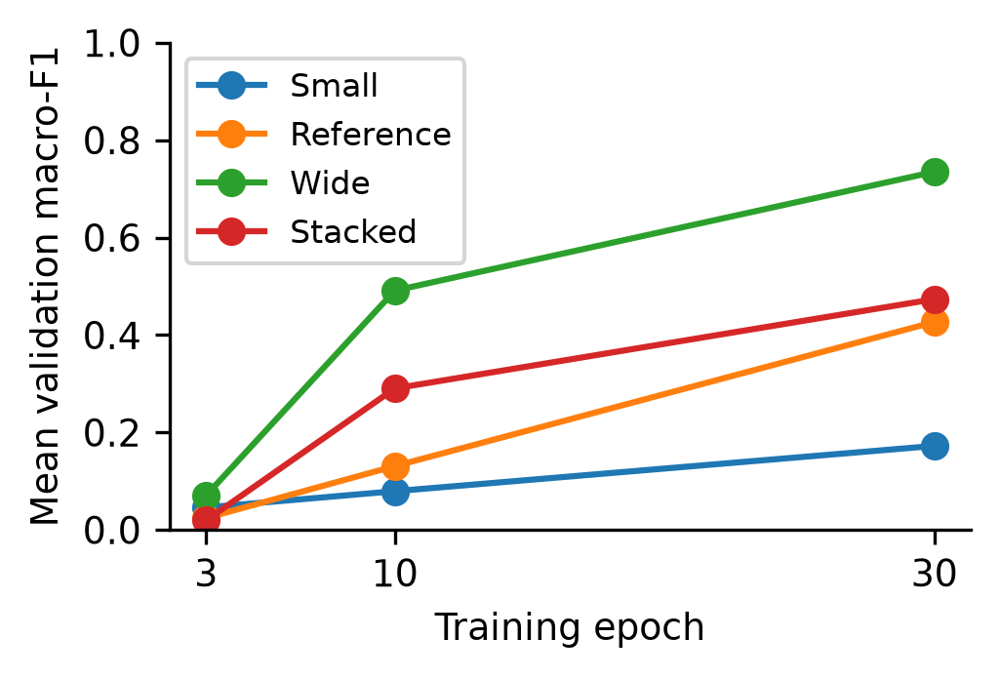
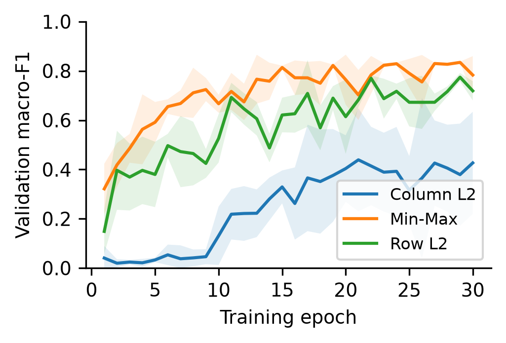
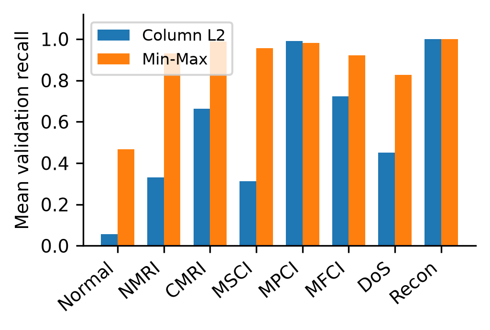
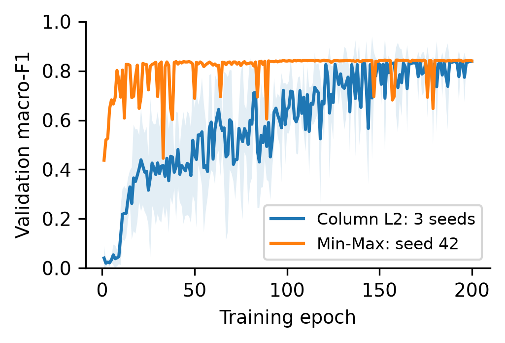
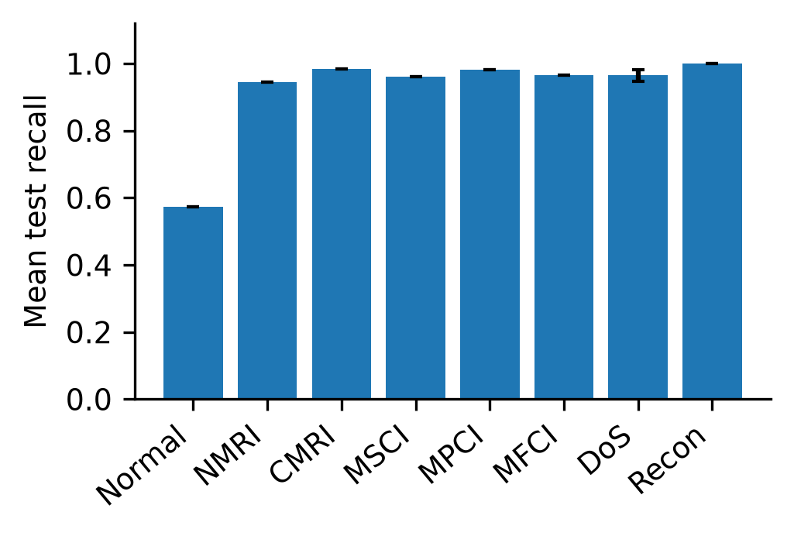
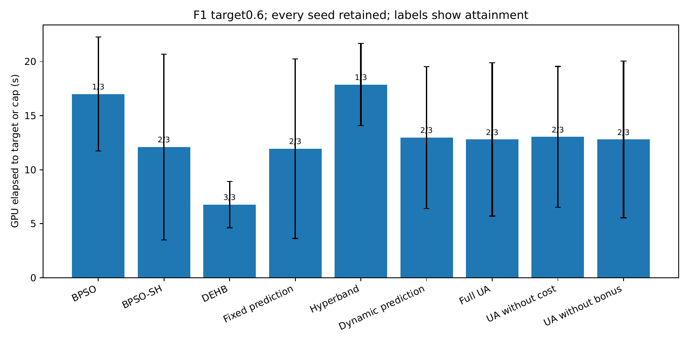
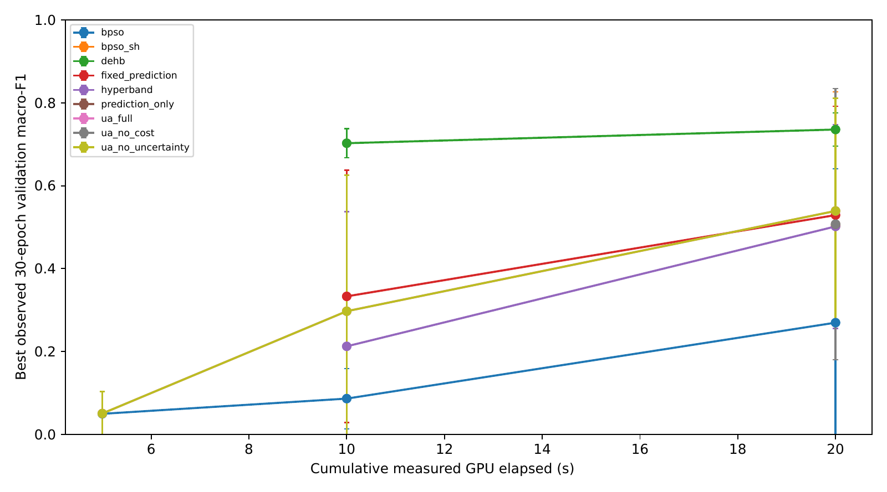
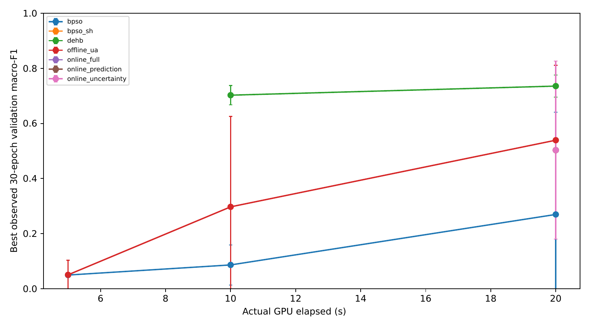

# CE-BPSO-AHDL-IDS: Compute-Efficient Binary Particle Swarm Optimization-Based Architecture Search for Hybrid Deep Learning Intrusion Detection in the Internet of Things

**Authors:** Abdur Rahim, Arpit Kumar Singh, Gosala Buela

**Affiliation:** IIITDM Kancheepuram, Chennai, India

**Experimental revision:** 8 November 2026

**Editorial synchronization:** 10 November 2026

## Abstract

Neural architecture search for intrusion detection requires useful evaluation under limited compute. This project retains a 73-bit BPSO CNN–RNN framework and investigates multi-fidelity allocation on real Gas Pipeline data. An earlier archive-based uncertainty-aware (UA) method reduced online GPU use but required 403.82 GPU seconds of predictor observations, eliminating end-to-end savings. We implement an archive-free candidate that begins as BPSO with successive halving (SH). It learns only from search-generated observations using architecture-disjoint, prequentially checked CPU prediction. In 42 fresh compute-limited runs across three seeds, the full archive-free method used 11.947 GPU seconds on average. This is the mean time to reach a validation macro-F1 of 0.6 or to exhaust the cap. Standard BPSO used 16.824 GPU seconds, giving a reduction of 28.99% in total GPU computation. Targets were attained in 2/3 versus 1/3 seeds. However, predictive promotion never activated in the short searches. Results matched ordinary halving, so the measured saving is attributable to multi-fidelity fallback rather than online uncertainty learning. DEHB, the strongest baseline, reached 3/3 targets using 6.778 GPU seconds. Existing test results use a historical split already known during development. The work supports reproducible engineering and removal of archive overhead; superiority or novelty of uncertainty-aware optimization remains unsupported.

**Keywords:** 
Intrusion detection, neural architecture search, binary particle swarm optimization, compute efficiency, class imbalance.

## 1. Introduction

An intrusion detector must identify rare attacks while limiting false alarms on normal traffic. A hybrid neural model requires choices about depth, recurrent units, optimizer and training duration. Each candidate must be trained. Architecture search explores these choices, and shorter runs reduce its cost. The scores from shorter runs must still distinguish promising candidates.

We use BPSO-AHDL-IDS, the convolutional and recurrent architecture-search framework proposed by Lu et al. [1], to study model selection with limited computation. The research question was whether fitness from short training runs provided useful evidence about later validation performance after ordinary learning and preprocessing controls were examined. If a model predicts only one class, its accuracy can be misleading and different architectures can receive the same fitness. We therefore check the learning setup and preprocessing before treating such results as a reason to change the search algorithm.

This study supports four contributions. (1) We provide an executable compute-efficient BPSO framework with explicit reproduction choices and validation-only search. (2) We conduct a repeated-seed, four-preset study of 3/10/30-epoch fitness and selected 200-epoch learning trajectories. (3) We examine normalization, neural-component and predictor-state grouping controls on real Gas data. (4) We provide a fixed 200-epoch reference evaluation at three dedicated final-training seeds. The follow-up adds FP32 execution optimization, target-stopping and measured-GPU-compute experiments. The supported contributions concern empirical findings and reproducibility. A separate candidate extension adds architecture-disjoint learning-curve prediction and uncertainty-aware resource allocation, with matched-time comparisons and ablations (Section VI). We claim no new BPSO update, and algorithmic novelty has not been established.

## 2. Related Work

The source method [1] encodes network choices as binary strings and uses BPSO to search for a hybrid CNN/recurrent model. The source study reported Gas accuracy of 0.9897 and F1 of 0.9744. We include these measurements only for reference. Unknown source-paper partition identities, seeds, feature ordering and multiclass averaging prevent a controlled numerical reproduction claim.

We include random search [2] as a baseline for selecting architectures without a guided proposal rule. Successive halving [3] increases the training allocated to candidates that survive each rung. Hyperband [4] runs several of these brackets. DEHB [5] adds differential-evolution proposals to Hyperband; BOHB [6] uses model-based proposals with multi-fidelity allocation. Adaptive compute allocation is therefore a baseline requirement, not evidence of novelty. We did not implement BOHB.

Do scores from short training runs in this IDS search space reject candidates that improve with more training? We also test whether another allocation rule improves selection with the same resources. These are questions about the tested search space, not assumptions about architecture search in general. The original Gas documentation [7, 8] also motivates explicit label verification and scrutiny of operating-state dependence.

## 3. Problem Formulation and Methodology

### 3.1. Architecture Selection Under Compute Limits

For architecture $a$, training seed $s$ and $b$ cumulative training epochs, define

$$
f_b(a,s)=\mathrm{F1}_{\mathrm{macro}}(D_{\rm va};\operatorname{Train}(a,D_{\rm tr},b,s)).
$$

The search maximizes observed validation fitness under an experimental cap. For evaluation requests $q$ with incremental completed epochs $\Delta e_q$, the resource-limited form is

$$
\max_a f_B(a,s)\quad\text{subject to}\quad\sum_q\Delta e_q\leq C_e.
$$

Resource caps can bound search wall time or measured GPU training/validation elapsed time. The fixed-quality protocol stops when an actual 30-epoch candidate reaches the target or the compute cap is exhausted; fixed-compute comparisons use common GPU horizons. Epochs do not equal FLOPs across different models. An equal cap also need not imply equal consumption, because a full promotion may not fit the remaining allowance. Actual epochs, selected fidelity, elapsed search time and failures must therefore accompany a method comparison.

Search uses training and validation only. Architecture, preprocessing, loss and training duration are fixed before final evaluation. Following the validation studies, the reference hybrid was independently initialized using three dedicated training seeds. Evaluation used the existing test split after exactly 200 epochs. This fixed-reference evaluation is separate from BPSO candidate selection and from the earlier validation continuations.

### 3.2. Hybrid Model and Encoding

**Figure 1. Framework architecture. Recurrent blocks traverse the transformed feature axis of one tabular record. Test data are used after the architecture and training endpoint have been fixed.** See the [framework diagram](../latex/manuscript.pdf).

Each record $(N,F)$ is reshaped to $(N,1,F)$ for one-dimensional convolution, activation and max pooling. The tensor is then transposed to $(N,L,C)$ for sequence-preserving RNN, LSTM, GRU or linear blocks. A classifier reads the last sequence position. This is feature-axis processing, not a temporal window of successive events. Encoded recurrent activations follow each module; native PyTorch recurrent gates are retained.

The paper-informed codec has 73 bits. Eight bits encode batch size, optimizer and learning rate, and two bits encode CNN count. The remaining allocation is four ten-bit CNN slots, one bit for recurrent count, and two eleven-bit recurrent slots. Cache keys use only the active parts of the decoded architecture. Fixed-slot count mappings, pooling, output aggregation and feature order were explicit implementation choices. If an operation is invalid for a short feature sequence, the implementation pads the sequence and records the repair. This policy and the encoding are documented choices. The original authors' code was unavailable for an exact comparison.

### 3.3. Training and Swarm Update

The minibatch objective is

$$
\begin{aligned}
 \mathcal L={}&-\frac{\sum_{i\in B}\alpha_{y_i}\log p_\theta(y_i\mid x_i)}{\sum_{i\in B}\alpha_{y_i}}\\
 &+\lambda_1\!\sum_{W\in\mathcal W_r^{(1)}}\|W\|_1
 +\lambda_2\!\sum_{W\in\mathcal W_r^{(2)}}\|W\|_F^2.
\end{aligned}
$$

Balanced weights are proportional to inverse training-class frequency and normalized to unit mean. Validation and test frequencies are not used to fit them. The encoding applies L1/L2 penalties to recurrent weights, although the preset controls evaluated here did not enable them. Unweighted loss is the framework default. We explicitly enabled balanced loss for this study.

Let $x_{ij}$ denote the particle position, $p_{ij}$ its personal best and $g_j$ the global best. The BPSO update is

$$
\begin{aligned}

 w_t&=w_{\max}-(w_{\max}-w_{\min})t/G,\\
 v'_{ij}&=w_tv_{ij}+c_1r_{1,ij}(p_{ij}-x_{ij})+c_2r_{2,ij}(g_j-x_{ij}),\\

\end{aligned}
$$

Before updating the position, $v_{ij}$ is assigned the updated velocity $v'_{ij}$, with any out-of-range value replaced by an independent Uniform$[0,1]$ draw.

$$
\begin{aligned}

 x'_{ij}&=\mathbf{1}\{r_{ij}\leq\sigma(v_{ij})\}.

\end{aligned}
$$

The function $\sigma$ is the logistic sigmoid. Each random factor is sampled independently. A best record changes only when validation macro-F1 strictly improves. We treat the conflicting global-best inequality in the printed source as a typographical error. The search returns candidates that were actually evaluated.

**Algorithm 1: compute-efficient search with cumulative training.**

-  Record the raw-file checksums, split IDs, training transforms, codec, seeds and compute limits before starting.

-  Start the scheduler and request a candidate configuration.

-  Decode the architecture. Resume the checkpoint matching its seed, data and configuration, or initialize it if none exists.

-  Train to the requested cumulative training duration and preserve optimizer/RNG state. Then score validation macro-F1.

-  Record incremental resource use, update the scheduler and promote or propose candidates until the schedule or cap ends.

-  Record the best observed candidate and its fidelity. Evaluate a separately frozen final model on locked test data only when that experiment is performed.

We implemented seven paths. These comprise BPSO, reduced BPSO, BPSO with successive halving, random, Hyperband, upstream DEHB 0.1.1 and a conventional random-forest proposal control. BPSO with halving updates swarm bests only from final-rung fitness. Paper-informed Gas settings specify 20 particles, 30 populations, 30 candidate epochs and 200 final epochs, with $c_1=c_2=1.5$, inertia settings 0.8/0.4 and velocity bounds $\pm10$.

## 4. Data and Experimental Protocol

### 4.1. Dataset and Preprocessing

The Gas ARFF came from the dataset author's link and contained 97,019 records. It had 26 numeric predictors and eight target codes. The source hash and feature allowlist were preserved, and Table 1 follows the dataset documentation [7, 8] for code meanings. Stratified splitting with seeds 1729/1730 produced 58,211 training records, with 19,404 records each for validation and test. These partitions were fixed. They do not recover the row identities in the source paper.

**Table 1. Verified Gas Pipeline class names. Original numeric targets were preserved.**

| Class (code) | Meaning |
| --- | --- |
| Normal (0) | Normal operation |
| NMRI (1) | Naive malicious response injection |
| CMRI (2) | Complex malicious response injection |
| MSCI (3) | Malicious state command injection |
| MPCI (4) | Malicious parameter command injection |
| MFCI (5) | Malicious function command injection |
| DoS (6) | Denial of service |
| Recon (7) | Reconnaissance |

We fitted imputation and normalization on training data only and removed alternate target columns. The column L2, row L2 and Min–Max experiments shared training/validation rows and the fitted imputer. Column L2 divides each feature by its training-column norm. Zero norms are replaced with one. Row L2 uses each record's own norm. Min–Max parameters came from training extrema, and no transformation was fitted to validation extrema.

In the original source, `time` means the Modbus query–response interval [7]. It is not an acquisition timestamp, so sorting it cannot establish chronology. Original ToN-IoT, Bot-IoT and SWaT data were unavailable; generated profiles served only as software fixtures and supplied no original-benchmark efficacy evidence.

### 4.2. Preset Cohort and Neural Controls

The repeated-seed study froze four hybrid presets before reading new scores. Each used Adam with a learning rate of 0.001 and a batch size of 256. Training used balanced cross entropy, a clipping norm of 1 and GRU dropout of 0.1. Small, reference and wide presets used CNN/GRU widths 8/16, 16/32 and 32/64. Their CNN kernel size was 3 and their pool size was 2. The stacked preset added a CNN32 block with pool size 1 to the reference CNN16 block, followed by GRU32. The cohort was a controlled four-preset sensitivity study, not a sample of the full 73-bit search space.

All four presets reached 3, 10 and 30 epochs under column L2 for seeds 42, 43 and 44. The reference also reached these training durations under Min–Max and row L2. The additional Min–Max models were MLP64/32, CNN16 with a flattened 32-unit head, and GRU32 over the feature sequence. We used them as conventional model-family controls. Their widths, readouts and parameter counts differ, so the scores cannot isolate a single component's effect at equal capacity.

Before observing later scores, we specified 200-epoch continuations for all three column-L2 reference seeds. We also specified one for the Min–Max reference at seed 42. Each continuation resumed its existing weights. These four runs extend earlier fits and are not additional independent fits. The extension contained 27 neural trajectories through epoch 30, plus four longer continuations.

### 4.3. Predictor-State Grouping

With all 26 features included, the original random partitions had no exact predictor overlap. With time excluded, training and validation shared 2,033 predictor hashes. Training and test shared 2,087. Across the full corpus, 105 non-time predictor hashes had conflicting labels. The audit identifies repeated states but does not measure their effect on scores.

For a separate sensitivity split, we grouped identical states across the 25 non-time features. The hashes used predictors alone, without labels. Seeded group splitting reserved 20% of groups and split the remaining pool into training and validation groups. It produced 62,198 training, 14,462 validation and 20,359 reserved rows across 7,675 unique groups, with zero shared groups between partitions. Every class occurred in training and validation. Only training/validation arrays were made available to the new runs.

This split evaluated balanced 100-tree random forests, balanced logistic regression with training-fitted standard scaling, and the reference hybrid for seeds 42/43/44. The hybrid used training-fitted Min–Max and was trained for 30 epochs. Grouping separates exact predictor states in this release. Capture identities and actual timestamps are unavailable, so near-duplicate records may still be dependent. Row counts, class proportions and hardware also differ between the grouped and random experiments. Their score difference cannot measure leakage alone.

### 4.4. Metrics, Repeats and Hardware

Macro-F1 covers all eight training classes, with zero assigned to undefined class metrics. We also report accuracy, per-class recall, predicted-class coverage, confusion matrices and the normal-versus-attack false-positive rate (FPR). The majority baseline always predicts the most frequent training label. Means and sample standard deviations summarize training variability across three seeds on one partition. They do not measure variation across independently collected datasets.

For each seed, we compared the same four candidates using Spearman/Kendall correlation. We also measured selection regret, $\max_a f_{30}(a)-f_{30}(\arg\max_a f_b(a))$. Statistics remained undefined for constant rankings. When selection-boundary ties prevented a unique choice, we reported regret intervals. Four candidates cannot characterize the full search space.

The random-split neural runs and final reference evaluations used an RTX 3050 Laptop GPU with 4 GB, Python 3.14.4, PyTorch 2.15.0 and CUDA 13.2. We ran the state-grouped hybrid controls on CPU and saved the environment and timing records with each experiment. An epoch counts a training pass, not a fixed amount of computation. Synchronized GPU seconds measure elapsed occupancy rather than energy. No test arrays were present in the validation-study directories. Final evaluation reused the original test partition, with its earlier outcomes already known. This was neither a new blind test nor an evaluation on an independent release.

### 4.5. Fixed-Endpoint Reference Evaluation

The CNN16–GRU32 reference used training-fitted Min–Max scaling and balanced cross entropy. Training used Adam at learning rate 0.001, batch size 256, dropout 0.1 and gradient clipping at norm 1. We fixed seeds 10042, 10043 and 10044 before reading new test predictions. Each run used 200 epochs and an independent initialization; validation peaks did not select checkpoints or stop training. We verified the source checksum and every partition row identity against the original preparation. Test predictions were generated only at the fixed endpoint. We then re-scored them independently to measure the fixed reference's training variability on the existing split. The model was not selected by a full-length BPSO search.

## 5. Results

### 5.1. Training-Duration Sensitivity

**Table 2. Validation macro-F1, mean ± sample SD over three training seeds, complete four-preset column-L2 cohort.**

| Preset | Epoch 3 F1 | Epoch 10 F1 | Epoch 30 F1 |
| --- | --- | --- | --- |
| Small | 0.0460 ± 0.0460 | 0.0794 ± 0.0632 | 0.1724 ± 0.0478 |
| Reference | 0.0243 ± 0.0094 | 0.1309 ± 0.1186 | 0.4267 ± 0.2074 |
| Wide | 0.0705 ± 0.0550 | 0.4912 ± 0.0715 | 0.7348 ± 0.0868 |
| Stacked | 0.0194 ± 0.0142 | 0.2903 ± 0.2629 | 0.4735 ± 0.1835 |

**Table 3. Within-seed early-to-30-epoch rankings for four presets. Dashes denote non-identifiable statistics, not zero.**

| Seed | Early epoch | Spearman | Kendall | Regret |
| --- | --- | --- | --- | --- |
| 42 | 3 | 0.9487 | 0.9129 | 0.0000 |
| 42 | 10 | 0.8000 | 0.6667 | 0.0000 |
| 43 | 3 | 0.3162 | 0.1826 | 0.0284 |
| 43 | 10 | 0.8000 | 0.6667 | 0.0000 |
| 44 | 3 | 0.2000 | 0.0000 | 0.0000 |
| 44 | 10 | 0.8000 | 0.6667 | 0.0000 |

The complete cohort appears in Tables 2 and 3. For every seed, the epoch-10 winner remained best at epoch 30. At epoch 10, regret was zero and Spearman correlation was 0.8 for every seed. Epoch-3 regret was positive only for seed 43 (0.0284). Other presets changed order. We observed no large failure to retain the later winner within the four tested presets and training durations. This does not show that a new allocation rule would improve selection. We did not infer an unobserved full-cohort ranking from a selected 200-epoch subset.

### 5.2. Normalization and Component Controls

**Table 4. Reference CNN–GRU at 30 epochs on the frozen random split. Macro-F1 shows mean ± sample SD; accuracy and FPR show means across three seeds.**

| Scaling | Macro-F1 | Accuracy | FPR |
| --- | --- | --- | --- |
| Column L2 | 0.4267 ± 0.2074 | 0.3136 | 0.9442 |
| Min–Max | 0.7831 ± 0.0768 | 0.6550 | 0.5324 |
| Row L2 | 0.7190 ± 0.0390 | 0.6710 | 0.4934 |

The reference obtained mean macro-F1 0.4267, 0.7190 and 0.7831 under column L2, row L2 and Min–Max, respectively. Scaling affected scores in this experiment. This does not establish Min–Max as the best choice in other settings. A preprocessing gain also does not establish a new search method.

**Table 5. Conventional neural controls with Min–Max at 30 epochs; three training seeds. Component capacities and readouts differed.**

| Model | Macro-F1 | Accuracy | FPR | Params. |
| --- | --- | --- | --- | --- |
| MLP | 0.8325 ± 0.0012 | 0.7247 | 0.4217 | 4,072 |
| CNN | 0.8275 ± 0.0032 | 0.7233 | 0.4221 | 7,016 |
| GRU | 0.7510 ± 0.0709 | 0.6416 | 0.5469 | 3,624 |
| CNN–GRU | 0.7831 ± 0.0768 | 0.6550 | 0.5324 | 5,128 |

The MLP, CNN-only and GRU-only results are given in Table 5. Both the MLP and CNN-only model had higher mean validation macro-F1 than the reference hybrid at this training duration. The experiment therefore did not establish a hybrid advantage. We include parameter counts and FPR because model capacity and errors on normal traffic also matter. The Min–Max reference flagged an average of 53.24% of normal validation records as attacks, compared with 42.17% for the MLP. These false-alarm rates do not support deployment readiness. Differences in the remaining model settings also prevent attributing the scores solely to recurrence or convolution.

### 5.3. Longer Training and State-Grouped Validation

**Table 6. Selected reference continuations to 200 epochs. Column L2 used three seeds; Min–Max used seed 42 only. All measurements are validation-only.**

| Scaling | Seeds | Epochs | Macro-F1 | Accuracy |
| --- | --- | --- | --- | --- |
| Column L2 | 3 | 200 | 0.8390 ± 0.0084 | 0.7267 |
| Min–Max | 1 | 200 | 0.8407 (n=1) | 0.7264 |

After 200 epochs, the column-L2 reference had mean validation macro-F1 0.8390, while the one Min–Max continuation reached 0.8407. Scaling therefore affected the comparison differently at different training durations. The unequal seed counts also prevent a general conclusion about which scaling method is best. These runs extend the earlier reference trajectories. The separate final-seed evaluation below supplies fixed-endpoint test measurements; a full-cohort comparison with longer training remains outstanding.

**Table 7. State-grouped validation, mean ± sample SD over three training seeds. Its validation rows differ from those in the random split.**

| Model | Macro-F1 | Accuracy | FPR |
| --- | --- | --- | --- |
| Random forest | 0.8372 ± 0.0010 | 0.8480 | 0.1885 |
| Logistic | 0.8018 ± 0.0000 | 0.6806 | 0.4902 |
| CNN–GRU | 0.7559 ± 0.0804 | 0.6077 | 0.6158 |

The state-grouped reference achieved mean validation macro-F1 0.7559 (Table 7) under zero exact non-time state-group overlap. It does not establish capture-level independence, prospective detection or cross-release performance. The reserved group partition was not evaluated by a model.

### 5.4. Fixed-Endpoint Test Evaluation

**Table 8. Fixed CNN16–GRU32 reference after 200 epochs with Min–Max scaling and balanced loss. Validation and test F1 are macro-averages. The historical random-split test partition was retained.**

| Seed | Val. F1 | Test acc. | Test F1 | FPR |
| --- | --- | --- | --- | --- |
| 10042 | 0.8416 | 0.7242 | 0.8456 | 0.4268 |
| 10043 | 0.8423 | 0.7236 | 0.8441 | 0.4271 |
| 10044 | 0.8436 | 0.7243 | 0.8465 | 0.4271 |

The three independent initializations obtained mean test macro-F1 0.8454 ± 0.0012, mean accuracy 0.7240 and mean normal-class FPR 0.4270 (Table 8). All three prediction archives reproduced their saved classification metrics and confusion matrices. These results extend the evidence beyond verification with short training runs, but they do not identify a BPSO-selected winner or demonstrate a search benefit. The earlier ten-epoch reference used different scaling and training duration, so the difference cannot be attributed to a single factor. Repeating training with different seeds measures training variability. It does not provide independent test data: the runs share test rows, and repeated operating states create dependence among records.

**Table 9. Mean final test class metrics across three training seeds. Support is the fixed test class count.**

| Class | Precision | Recall | F1 | Support |
| --- | --- | --- | --- | --- |
| Normal | 0.9847 | 0.5730 | 0.7244 | 12,231 |
| NMRI | 0.0944 | 0.9439 | 0.1717 | 553 |
| CMRI | 0.9374 | 0.9845 | 0.9604 | 3,093 |
| MSCI | 0.9677 | 0.9615 | 0.9646 | 156 |
| MPCI | 0.9810 | 0.9804 | 0.9807 | 1,528 |
| MFCI | 1.0000 | 0.9652 | 0.9823 | 115 |
| DoS | 0.9944 | 0.9646 | 0.9792 | 367 |
| Recon | 1.0000 | 1.0000 | 1.0000 | 1,361 |

Table 9 explains the gap between macro-F1 and accuracy. Normal recall was approximately 0.5730, while NMRI precision was approximately 0.0944 despite NMRI recall of 0.9439. About 42.70% of normal records were flagged as attacks, predominantly NMRI. Thus high attack recall coexisted with substantial false alarms, and aggregate macro-F1 alone would overstate practical detector quality. No post-test tuning was performed to reduce these errors.

### 5.5. Validation-Selected False-Alarm Correction

The balanced-loss reference was followed by an exploratory comparison of unweighted and square-root inverse-frequency weighting. Architecture, preprocessing, optimizer and the 200-epoch endpoint were held fixed. Candidate training used seed 42 and training/validation arrays only. Neither candidate met the initial 1% validation false-alarm target with at least 90% attack detection. Before generating new test predictions, the false-alarm limit was revised to 3%, retaining the detection constraint. Square-root weighting was selected by validation macro-F1 (0.8552 versus 0.8480 for unweighted loss).

The exploratory validation-selected square-root weighting correction reduced mean normal test false alarms from 42.70% to 1.90%, with accuracy 95.44%, macro-F1 0.8551 and attack detection 90.96%. However, NMRI recall fell from 94.39% to 0.54%. This is a false-alarm versus attack-sensitivity trade-off, not a complete detector-quality solution; the original 1% false-alarm target remains unmet. Independent evaluation is still required.
The selected setting was evaluated at paired final seeds 10042, 10043 and 10044, each trained for exactly 200 epochs on GPU. These results describe a conventional loss correction on the historical split. The revised target is exploratory, and no test-driven threshold or endpoint selection was performed after these new predictions.

### 5.6. Dedicated NMRI Specialist

A subsequent validation-selected normal/NMRI specialist increased mean NMRI test recall from 0.54% to 16.82%, while normal false alarms rose from 1.90% to 2.60%. Accuracy was 95.46%, macro-F1 0.8854, and overall attack detection 92.23%. This improves the observed trade-off, but most NMRI attacks are still missed. The same training-fitted specialist was shared across three hybrid seeds; these are not three independent specialist fits or independent-dataset replicates.

The specialist was trained on normal/NMRI training rows and only reconsidered normal or NMRI hybrid predictions. Extra Trees, histogram gradient boosting and a GPU-trained neural specialist were compared on validation. No tested method achieved 50% NMRI recall below 5% false alarms. An explicitly revised exploratory criterion selected histogram gradient boosting by validation macro-F1. It required under 3% false alarms, at least 10% NMRI recall and 90% overall attack detection. All three validation thresholds were fixed before new test predictions. Training-only analysis found that 1,374 of 1,657 NMRI records shared their non-time predictor state with normal records. The audit leaves out duration, so it cannot establish that the full feature set is unable to distinguish the classes.

**Table 10. Observed test operating points. NMRI denotes class recall, and FPR is the normal false-positive rate. Means use three hybrid seeds; the specialist is shared.**

| Setting | FPR (%) | NMRI (%) | Acc. (%) | F1 |
| --- | --- | --- | --- | --- |
| Balanced | 42.70 | 94.39 | 72.40 | 0.8454 |
| Sqrt loss | 1.90 | 0.54 | 95.44 | 0.8551 |
| Specialist | 2.60 | 16.82 | 95.46 | 0.8854 |

### 5.7. Historical Evidence and Software Verification

The earlier ten-epoch held-out reference scored 0.299371 macro-F1 and 0.707792 accuracy, with no CMRI or MSCI records detected. We retained those results. The later validation experiments do not supply replacement test scores. Re-scoring saved predictions reproduced the checked metrics for 47 historical files.

The expanded software suite passed 74 tests per CPU and CUDA-configured run. Component-continuation checks explicitly use CPU, while device-aware checks also exercised CUDA. Compute-limited integration checks covered preparation, training, search, diagnostics, seven-method comparison, reporting and search resume. They used real Gas data and three synthetic profiles. Tests covered train-fitted transforms, encoding, maximization, resource caps, native scheduler replay and tie-aware rankings. The synthetic results support software execution only. These checks support covered behavior, not every architecture or deployment condition.

## 6. Computational Efficiency of Adaptive Multi-Fidelity BPSO

### 6.1. Diagnosis and experimental correction

The earlier matched-wall study gave each method 30 seconds with high iteration ceilings and no target-stop rule. It therefore measured quality with the same compute allocation rather than the computation saved in reaching a common quality. BPSO and UA each consumed about 28.76 GPU seconds. Predictor calls cost about 0.10 seconds; the predictor's archive cost 403.82 GPU seconds. Continuation and decoded-architecture deduplication were already functioning. Execution overhead came from per-example batching, scalar synchronization and dense validation. Repeated model/checkpoint loading added further overhead.

We use separate fixed-quality and fixed-compute experiments. For target $\tau$, $T(\tau)$ is the cumulative measured GPU elapsed time to the first actual 30-epoch candidate reaching validation macro-F1 $\tau$. Misses are right-censored at the compute limit $B$. Restricted completion time is $\min(T,B)$, and every seed remains in the comparison. Fixed-compute experiments compare the best actual 30-epoch scores at common GPU limits. They cannot by themselves prove cost saving.

GPU elapsed time follows the original convention of synchronized training/validation elapsed time. It includes host stalls within those intervals, so it measures neither pure kernel time nor energy. Search wall time also includes predictor, scheduling, checkpoint and import overhead. GPU caps are checked after completed epochs. The final epoch can therefore overrun. Score comparisons under a strict compute limit exclude terminal observations beyond the stated limit.

### 6.2. Engineering and candidate policy

Vectorized batches preserve the original sampler and RNG order. Data/resident-tensor caches with fixed capacity reduce loading and transfers. A one-model cache keyed by trial directory avoids redundant reconstruction and optimizer loading during immediate continuation. FP32 loss-scalar synchronization is deferred. Validation runs at epochs 3/10/30, while checkpoints still commit every epoch. Across three development architectures, cumulative GPU elapsed time fell from 25.059 to 20.182 seconds (19.47%). Final parameter tensors were identical. These fixed-order, one-pass profiles have limited precision. We rejected automatic mixed precision (AMP) because it changed outcomes beyond the 0.01 development tolerance. Batch sizes and the search space stayed unchanged.

The candidate starts by probing two particles. It then selects continuations dynamically, without a fixed halving quota. At most two promotions can occur before a new probe is forced. Its priority is

$$
\begin{aligned}
P(a)={}&\widehat f_{30}(a)+\beta u(a)\\
&-\lambda\frac{\widehat c(a)}{\operatorname{median}_{z\in\mathcal A}\widehat c(z)},
\end{aligned}
$$

where $u(a)$ is the calibrated prediction radius for architecture $a$, $\beta$ weights the uncertainty bonus and $\lambda$ weights the median-normalized remaining-compute cost. The cost estimate $\widehat c$ accounts separately for remaining training epochs and validation passes. A candidate stops if its full prediction upper bound falls below the best observed 30-epoch score plus 0.01. Low initial F1 alone does not stop it. Only actual terminal scores update BPSO attractors, and every predictive variant retains the same 20% diversity restart.

Existing logs are used to refit the sparse, timing-invariant forest. Architecture-disjoint development replay on IDs 0–11 fixed $\beta=0.1$, $\lambda=0.2$ before the new search seeds. The split-conformal residual construction [9] retains calibration IDs 12–17 and held-out IDs 18–24. Nominal 80% intervals covered 13/14 held-out observations at epoch 3 and 14/14 at epoch 10. Their mean widths were 0.573 and 0.481, respectively. These broad intervals do not guarantee useful calibration under adaptive proposal shift. No new GPU archive was collected, but historical collection cost is still charged.

### 6.3. Measured quality, cost and ablations

Nine methods/ablations used seeds 601–603 and the same 8192/4096 training/validation view with all eight classes. They used original training-fitted Min–Max preprocessing, balanced loss, FP32 runtime and a maximum fidelity of 30. The initial 8-GPU-second pilot executed independent targets 0.4/0.5/0.6 and fixed-compute runs. BPSO missed target 0.6 in all three pilot runs and SH reached it only once, so we extended the target-0.6 and fixed-compute experiments to 20 GPU seconds. The declared exploratory continuation retained all methods/seeds/coefficients, resumed saved optimizer/RNG states, and charged every previously spent epoch, GPU second and wall second, including checkpoint-import overhead. It is not a new independent replication.

**Table 11. Target 0.6: actual mean GPU elapsed time to target or cap, with all three seeds retained. Misses are censored rather than excluded. Scores are actual terminal validation macro-F1. Archive cost is separate.**

| Method | GPU s | F1 | Saving (%) | Hits |
| --- | --- | --- | --- | --- |
| BPSO | 17.01 | 0.264 | 0.0 | 1/3 |
| BPSO-SH | 12.10 | 0.497 | 28.8 | 2/3 |
| DEHB | 6.78 | 0.703 | 60.2 | 3/3 |
| Fixed prediction | 11.94 | 0.529 | 29.8 | 2/3 |
| Hyperband | 17.88 | 0.502 | -5.1 | 1/3 |
| Dynamic prediction | 12.98 | 0.507 | 23.7 | 2/3 |
| Full UA | 12.80 | 0.539 | 24.7 | 2/3 |
| UA without cost | 13.03 | 0.507 | 23.4 | 2/3 |
| UA without bonus | 12.80 | 0.539 | 24.7 | 2/3 |

Full UA used 12.803 GPU seconds versus 17.008 for BPSO: a 24.72% online reduction, just below the 25% engineering goal. It attained 2/3 targets versus 1/3 for BPSO. SH used 12.103 seconds with 2/3 hits, so full UA was 5.78% slower. DEHB used 6.776 seconds, attained 3/3 targets and saved 60.16% versus BPSO. These comparisons cover three seeds over finite horizons and do not establish statistical superiority. The restricted-time saving of 25.14% is a different censored estimand and cannot be used to claim the 25% goal was met.

With a fixed 20-second compute allocation, mean validation macro-F1 was 0.5391 for full UA, 0.2696 for BPSO, 0.5030 for SH and 0.7356 for DEHB. The full-method gap to DEHB was 0.1965, exceeding the 0.02 preservation margin. Removing the uncertainty bonus changed no terminal winner scores. Removing cost reduced mean F1 by 0.0320, but cost-aware UA still did not beat SH on target-time cost. Fixed-quota prediction used 11.940 target-or-cap GPU seconds and F1 0.5291; dynamic prediction used 12.978 and 0.5071. The more complex allocation is not independently supported as an improvement.

### 6.4. Total cost, final models and limitations

Charging the historical archive gives 416.622 GPU seconds for one full-UA quality search versus 17.008 for BPSO: no net single-search saving remains. The fit/calibration subset alone cost 308.386 historical GPU seconds. Smaller-log CPU refits reduced that attributable subset but increased held-out point-prediction error; they were not substituted into the frozen benchmark. Historical reuse is not free computation. Online calibration was not claimed from a few adaptively selected terminal observations.

All methods' fixed-compute architecture choices were frozen before final testing, using dedicated seed 1601 and 30 epochs. The previously examined historical test is not blind independent data. BPSO test macro-F1 was 0.2733, with normal FPR 0.8038. BPSO-SH test macro-F1 was 0.5759, with normal FPR 0.6180; for Full UA, these values were 0.3100 and 0.9442, respectively. DEHB test macro-F1 was 0.6859, with normal FPR 0.7549. We retain precision, attack recalls, confusion matrices, parameters and measured inference latency. Generalization is limited by one final training seed and shared historical rows. The existing conventional MLP/CNN/GRU/reference results provide context.

At the preceding study stage, the regression suite passed 105 CPU tests and 50 targeted CUDA tests. We re-scored saved validation/test predictions and checked epoch ledgers.

DEHB is the strongest baseline. SH offers a simpler BPSO alternative and lower target-time cost than full UA. The runtime optimizations were verified. Novelty and superior uncertainty-aware allocation are not established. The initial pilot (Section VI-C) and the archive-free online extension (Section VI-E) are reported separately. More search/final seeds, full-training studies, independently validated calibration and independent captures are still needed.

### 6.5. Archive-free online extension

The archive-dependent result motivated a fresh experiment with separate bounds. Its implementation begins as ordinary BPSO–SH, with the same proposals, quotas and tie handling. It captures architecture, learning-curve prefix and measured incremental-cost features at epochs 3 and 10, attaching a terminal label only after actual epoch 30 training. No offline bundle, historical target, cross-method checkpoint or separately trained GPU archive enters this variant. Candidate maturation is charged to ordinary search work.

A fixed architecture hash assigns fit/calibration/check roles with expected proportions 50/20/30%. CPU random forests use 24 trees of maximum depth 4. All current query architectures are excluded from fitting and calibration, and check forecasts are frozen before their terminal labels arrive. At least six fit, four calibration and four prequential check architectures per rung are required. The point gate requires MAE$\leq0.08$. MAE must be at least 10% lower than that of current-F1 prediction. The absolute MAE improvement over that baseline must also be at least 0.005. The gate also requires Spearman$\geq0.3$. For uncertainty modes, empirical coverage must be at least 0.75 for nominal 80% intervals, with mean width at most 0.3. Current intervals must also meet the width limit. These are conservative engineering checks, not a proof of calibration under adaptive sampling.

The interval uses a separate calibration quantile of absolute residual divided by forest dispersion (floor 0.02). When useful, ranking follows the earlier priority equation. It uses generic frozen values $\beta=0.1$ and $\lambda=0.05$, with median-normalized measured remaining cost. Prediction-only sets both coefficients to zero; uncertainty-only sets $\lambda=0$. If a gate fails, ordinary SH ranking remains in use. Swarm bests update only from actual terminal observations. We retain fixed SH quotas to isolate ranking, without claiming a new BPSO equation or algorithmic novelty.

### 6.6. Fresh end-to-end comparison

The 42 new runs use seeds 601–603 and seven methods. They include target 0.6 and fixed 20-GPU-second phases. Dataset rows, eight labels, preprocessing, architecture space, FP32 execution and 3/10/30 fidelities match the preceding 20-second experiment. A 50-second wall safety cap also applies. Methods run serially in a seeded permutation, without importing earlier checkpoints. Misses remain censored. Strict-horizon quality excludes terminal evaluations beyond the cap, while actual resource consumption includes epoch-boundary overruns. Timing follows the existing synchronized elapsed convention.

**Table 12. Fresh target 0.6 runs, means across three search seeds. GPU seconds are measured; archive cost is charged to a standalone search. All misses are retained. Hits count actual terminal targets before the strict horizon.**

| Method | Online GPU | Archive | Total GPU | F1 | Hits |
| --- | --- | --- | --- | --- | --- |
| BPSO | 16.824 | 0.00 | 16.824 | 0.3054 | 1/3 |
| BPSO + SH | 12.004 | 0.00 | 12.004 | 0.4971 | 2/3 |
| DEHB | 6.778 | 0.00 | 6.778 | 0.7026 | 3/3 |
| Offline UA | 12.631 | 403.82 | 416.450 | 0.5391 | 2/3 |
| Online prediction | 11.919 | 0.00 | 11.919 | 0.4971 | 2/3 |
| Online + uncertainty | 11.950 | 0.00 | 11.950 | 0.4971 | 2/3 |
| Archive-free full | 11.947 | 0.00 | 11.947 | 0.4971 | 2/3 |

Archive-free full consumed 11.947 GPU seconds versus 16.824 for BPSO, a 28.99% total reduction, with 2/3 versus 1/3 target attainment. Terminal validation macro-F1 means were 0.4971 and 0.3054, respectively. SH used 12.004 seconds. Its winner scores matched those of the archive-free variants. The small 0.47% timing difference does not establish an advantage over SH. DEHB used 6.778 seconds and reached 3/3 targets. Removing the archive lowers standalone total cost relative to offline UA (416.450 seconds), but the online component itself must earn its cost.

Across the 18 matched online trials, predictive promotion activated 0 times and CPU fitting ran 0 times. Thus the new modes effectively executed SH in this short-horizon study. Their ablations do not establish any benefit from uncertainty or cost ranking. External archive cost is zero. This does not demonstrate an online-learning advantage. CPU preparation ranged 0.0017–0.0078 seconds per run and is included in search wall time.

With a fixed 20-second compute allocation, archive-free full preserved SH scores but trailed offline UA by 0.0361 and DEHB by 0.2325 absolute macro-F1. Both exceed the 0.02 engineering preservation margin; competitive quality against the strongest baseline was not maintained.

**Table 13. Fresh fixed 20-GPU-second comparison. F1 is the best genuinely evaluated 30-epoch validation macro-F1, mean (sample SD). Epoch counts and actual GPU elapsed time include charged incremental work.**

| Method | Terminal F1 (SD) | Epochs | GPU s |
| --- | --- | --- | --- |
| BPSO | 0.2696 (0.3715) | 178.7 | 20.040 |
| BPSO + SH | 0.5030 (0.3231) | 138.3 | 20.088 |
| DEHB | 0.7356 (0.0402) | 195.0 | 20.044 |
| Offline UA | 0.5391 (0.2719) | 205.0 | 20.201 |
| Online prediction | 0.5030 (0.3231) | 137.3 | 20.086 |
| Online + uncertainty | 0.5030 (0.3231) | 137.3 | 20.089 |
| Archive-free full | 0.5030 (0.3231) | 137.7 | 20.080 |

The full archive is charged once for a reusable multi-search campaign in the accompanying CSV, rather than once per seed. Offline CPU development preparation is not fully isolated. The recorded archive wall time of 420.722 seconds is therefore only a lower bound for full offline wall preparation. We record online CPU fitting/inference and scheduler costs separately. All saved validation predictions were independently re-scored, and epoch/GPU ledgers and architecture-disjoint feature/predictor identities were verified. The expanded suite passed 110 CPU and 55 targeted CUDA-configured tests.

The separate seed 601 diagnostic used 120.061 GPU seconds and 128.449 wall seconds. It matured 16 distinct terminal architectures, performed 1 CPU fit and applied prediction at 0 promotion decisions. Preparation consumed 0.0475 CPU wall seconds. Prediction was blocked 32 times by too few fit or calibration architectures and once by too few out-of-time check architectures. This is a cold-start diagnostic, not a matched performance comparison.

No new final detector test was executed in this extension. The preceding historical test results are retained. The evidence supports removing an uneconomic archive and using SH fallback; it does not support superior online uncertainty-aware allocation. DEHB remains the strongest baseline, with SH the simpler BPSO alternative. Stronger conclusions about online prediction would require more seeds, a longer matched compute horizon, useful online calibration and independent data.

## 7. Limitations and Remaining Research

The new measurements address several evidence gaps, although an adaptive-prediction advantage is not established. Full-scale comparisons of BPSO, random search, Hyperband and DEHB with matched actual resources remain incomplete. The four-preset study and short 25-architecture pilot leave full-training search reliability unresolved. They also lack a complete three-seed search study and a complete 200-epoch cohort. Preset rankings were measured under column L2. Another normalization may change them. Mean scores, learning curves and successful runs alone cannot establish statistical superiority or speedup.

The source paper leaves its splits, averaging, feature order and layer conventions uncertain. Our recurrent blocks process feature positions within one record, rather than a sequence of captured events. Normalization and component experiments cover one release and a few seeds. Grouping removed exact shared predictor states. Capture identities remain unknown, and class proportions changed. The dataset owner's warnings about operating conditions [10, 8] still apply. We have not evaluated the original ToN-IoT/Bot-IoT/SWaT releases or validated deployment. Nor have we measured energy savings or established equivalence across multiple GPUs.

The next experiments should use a fixed protocol, capture metadata or an independent release, matched-resource search controls and a locked final evaluation endpoint. Any proposed allocation rule also needs comparison with relevant prior methods and ablations of its components. Each of these requires additional measurements.

The new efficiency study adds explicit target stopping, actual GPU-compute comparisons and an exploratory charged continuation. Its controls, engineering profiles, censoring and archive-inclusive costs are reported in Section VI; none establish superior uncertainty-aware optimization.

## 8. Reproducibility

Each experiment retains its dataset checksum, predictor order, partition identities, preprocessing parameters and training settings. Imputation, scaling and class weights used training data alone. Validation used the same candidate identities at seeds 42, 43 and 44. Final reference training restarted at seeds 10042, 10043 and 10044, with evaluation after exactly 200 epochs. Checkpoints preserved model weights, optimizer state and random-number states so larger training allocations could continue earlier runs. Re-scoring saved predictions verified the metrics and confusion matrices. Means and sample standard deviations describe training variability on fixed partitions. Broader generalization requires independent releases.

## 9. Conclusion

The implemented framework supports examination of hybrid intrusion-detection models with limited computation. Training duration and normalization affected candidate fitness. At 30 epochs, reference validation macro-F1 was 0.7831 under Min–Max. Column L2 gave 0.4267. Across all three seeds in the four-preset cohort, the epoch-10 winner remained best at epoch 30. This warrants checking the training setup when early scores are weak.

At the fixed 200-epoch endpoint, independently initialized reference models reached mean test macro-F1 0.8454. The sample standard deviation was 0.0012. These scores describe a fixed hybrid on the existing split. They do not describe a BPSO-selected winner. Per-class errors, false alarms and repeated predictor states still limit the result. The project supplies a runnable framework and measurements of sensitivity to training duration. Larger matched-resource comparisons and independent evaluation data are needed to establish an adaptive-prediction advantage and deployment performance.

The archive-free follow-up removed separately trained GPU predictor observations and reduced total target-or-cap GPU cost by 28.99% relative to BPSO. The short matched searches remained in SH fallback. This saving therefore does not establish a contribution from online prediction or uncertainty. DEHB was the strongest baseline. The contribution of this work is a reproducible framework and a measured comparison of search methods under a fixed compute allocation. It does not show that uncertainty-aware allocation outperforms existing methods.

The exploratory square-root weighting correction was selected on validation data and reduced mean normal test false alarms from 42.70% to 1.90%. Accuracy reached 95.44%, macro-F1 0.8551 and attack detection 90.96%, while NMRI recall dropped from 94.39% to 0.54%. This trades attack sensitivity for fewer false alarms. It is not a complete detector-quality solution, and the original 1% false-alarm target remains unmet.

A subsequent normal/NMRI specialist was selected on validation data. Mean NMRI test recall rose from 0.54% to 16.82%, while normal false alarms increased from 1.90% to 2.60%. Accuracy was 95.46%, macro-F1 0.8854 and overall attack detection 92.23%. The observed trade-off improved, although most NMRI attacks are still missed. One training-fitted specialist served all three hybrid seeds. These runs are not three independent specialist fits or independent-dataset replicates.

## References

[1] Lu, Kang-Di; Yang, Yao-Wei; Zeng, Guo-Qiang; Peng, Chen; Geng, Guang-Gang; Weng, Jian. “BPSO-AHDL-IDS: Binary Particle Swarm Optimization-Based Automated Hybrid Deep Learning Model for Intrusion Detection of Internet of Things”. IEEE Transactions on Automation Science and Engineering. vol. 22. pp. 15859–15877. 2025. [DOI](https://doi.org/10.1109/TASE.2025.3572510).

[2] Bergstra, James; Bengio, Yoshua. “Random Search for Hyper-Parameter Optimization”. Journal of Machine Learning Research. vol. 13. pp. 281–305. 2012. [Source](https://www.jmlr.org/papers/v13/bergstra12a.html).

[3] Jamieson, Kevin; Talwalkar, Ameet. “Non-stochastic Best Arm Identification and Hyperparameter Optimization”. Proceedings of the 19th International Conference on Artificial Intelligence and Statistics. vol. 51. pp. 240–248. 2016. [Source](https://proceedings.mlr.press/v51/jamieson16.html).

[4] Li, Lisha; Jamieson, Kevin; DeSalvo, Giulia; Rostamizadeh, Afshin; Talwalkar, Ameet. “Hyperband: A Novel Bandit-Based Approach to Hyperparameter Optimization”. Journal of Machine Learning Research. vol. 18. no. 185. pp. 1–52. 2018. [Source](https://www.jmlr.org/papers/v18/16-558.html).

[5] Awad, Noor; Mallik, Neeratyoy; Hutter, Frank. “DEHB: Evolutionary Hyberband for Scalable, Robust and Efficient Hyperparameter Optimization”. Proceedings of the Thirtieth International Joint Conference on Artificial Intelligence. pp. 2147–2153. 2021. [DOI](https://doi.org/10.24963/ijcai.2021/296). [Source](https://ijcai.org/proceedings/2021/296).

[6] Falkner, Stefan; Klein, Aaron; Hutter, Frank. “BOHB: Robust and Efficient Hyperparameter Optimization at Scale”. Proceedings of the 35th International Conference on Machine Learning. vol. 80. pp. 1437–1446. 2018. [Source](https://proceedings.mlr.press/v80/falkner18a.html).

[7] Morris, Thomas; Gao, Wei. “Industrial Control System Traffic Data Sets for Intrusion Detection Research”. Critical Infrastructure Protection VIII. vol. 441. pp. 65–78. 2014. [DOI](https://doi.org/10.1007/978-3-662-45355-1_5). [Source](https://link.springer.com/chapter/10.1007/978-3-662-45355-1_5).

[8] Hsu, Jeff; Mudd, David; Thornton, Zach. “Project Report—SCADA Anomaly Detection”. Mississippi State University. 2014. Project period February 17–April 30, 2014; Table 1, PDF pp. 2–3. [Source](http://www.ece.uah.edu/~thm0009/icsdatasets/MSU_SCADA_Final_Report.pdf).

[9] Angelopoulos, Anastasios N.; Bates, Stephen. “A Gentle Introduction to Conformal Prediction and Distribution-Free Uncertainty Quantification”. 2021. [Source](https://arxiv.org/abs/2107.07511).

[10] Morris, Tommy. “Industrial Control System (ICS) Cyber Attack Datasets”. Accessed November 7, 2026. Distinguishes the older Gas/Water release from New Gas Pipeline. [Source](https://sites.google.com/a/uah.edu/tommy-morris-uah/ics-data-sets).
