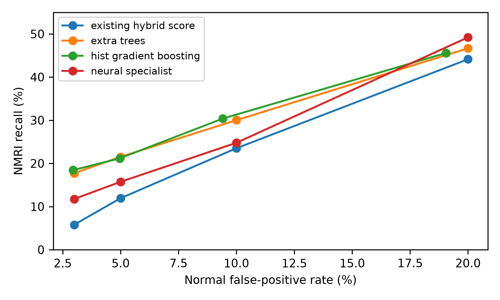

### 5.7 Dedicated NMRI specialist and remaining ambiguity

Further validation experiments compared the existing hybrid score with Extra Trees, histogram gradient boosting and a neural specialist. The specialists were fitted only on normal and NMRI training records. The neural specialist used GPU training for 100 epochs; the tree methods used CPU. Only predictions assigned to normal or NMRI by the fixed hybrid were reconsidered; other attack decisions were preserved. Threshold calibration included false alarms already assigned to other classes, and threshold ties remained normal.

No tested method reached the initial target of at least 50% NMRI recall with at most 5% false alarms and at least 90% overall attack detection. An exploratory follow-up was therefore explicitly recorded: select the highest validation macro-F1 among settings with at most 3% false alarms, at least 10% NMRI recall and at least 90% attack detection. Histogram gradient boosting was selected from validation data; its seed-42 validation NMRI recall was 18.44% at 2.95% false alarms. Before new test predictions, thresholds were calibrated separately for each of the three existing hybrid models using validation data only.

A subsequent validation-selected normal/NMRI specialist increased mean NMRI test recall from 0.54% to 16.82%, while normal false alarms rose from 1.90% to 2.60%. Accuracy was 95.46%, macro-F1 0.8854, and overall attack detection 92.23%. This improves the observed trade-off, but most NMRI attacks are still missed. The same training-fitted specialist was shared across three hybrid seeds; these are not three independent specialist fits or independent-dataset replicates.

| Test operating point | Normal false alarms | NMRI recall | Accuracy | Macro-F1 |
|---|---:|---:|---:|---:|
| Original balanced hybrid | 42.70% | 94.39% | 72.40% | 0.8454 |
| Square-root-weighted hybrid | 1.90% | 0.54% | 95.44% | 0.8551 |
| Hybrid with NMRI specialist | 2.60% | 16.82% | 95.46% | 0.8854 |

The training-only ambiguity audit found that 1,374 of 1,657 NMRI records shared their processed non-time predictor state with normal records; those states also contained 26,843 normal training records. Duration was excluded from that audit. This demonstrates substantial overlap, but it is not a proof that the full feature set cannot distinguish the classes. The small candidate comparison also cannot prove that no better model exists.

All three saved test prediction archives reproduce the reported metrics. A saved inference pipeline reproduces all 19,404 test decisions for the prespecified first hybrid seed. The revised CPU and CUDA-configured regression suites each pass 80 tests. The same previously examined split was reused, so all follow-up findings remain exploratory and require independent confirmation.

